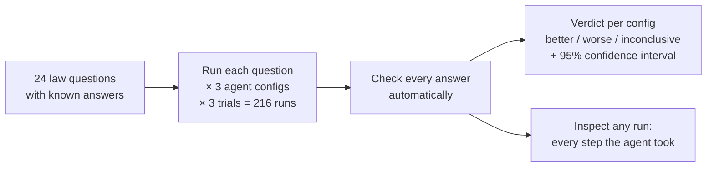

# Agent Eval Lab: product demo and walkthrough

This file walks you through the whole product with one sample run. It's written so you can follow it alone, or use it as a script when you demo the product to someone else.

**The one-line pitch:** *You changed your AI agent. Did it actually get better? Agent Eval Lab runs the same questions against each version of the agent several times, checks every answer against the truth, and tells you which version is better, how sure it is, and why each answer passed or failed.*

---

## Contents
1. [What you'll see](#1-what-youll-see)
2. [Setup (5 minutes)](#2-setup-5-minutes)
3. [The sample: Indian criminal law](#3-the-sample-indian-criminal-law)
4. [Demo A: in the dashboard (no API key)](#4-demo-a-in-the-dashboard-no-api-key)
5. [Demo B: from the terminal (CI style)](#5-demo-b-from-the-terminal-ci-style)
6. [Demo C: a real run with Hermes and OpenAI](#6-demo-c-a-real-run-with-hermes-and-openai)
7. [Behind the scenes of one run](#7-behind-the-scenes-of-one-run)
8. [How to read the results](#8-how-to-read-the-results)
9. [Make it your own](#9-make-it-your-own)
10. [A 5-minute presenter script](#10-a-5-minute-presenter-script)
11. [Troubleshooting](#11-troubleshooting)

---

## 1. What you'll see



By the end you'll have seen:
- an experiment **streaming live**, with each agent step appearing as it happens;
- a **verdict with a confidence interval** for each config;
- a **task diff** showing exactly which questions got better or worse;
- the **run inspector**, explaining why one answer was wrong (a repealed IPC section number).

---

## 2. Setup (5 minutes)

**You need:** Node 22+, pnpm, Python 3.11+. An OpenAI API key is only needed for Demo C.

```bash
cd hermes
cp .env.example .env          # leave OPENAI_API_KEY empty for now (Demos A and B don't need it)
pnpm start
```

What `pnpm start` does (it prints each step):

```
[1/6] Checking prerequisites        node 22.x · python 3.12
[2/6] Node dependencies             installs if node_modules is missing
[3/6] Hermes Agent 0.15.2           first run only: creates .venv and installs Hermes (≈ 1 min)
[4/6] Configuration (.env)          warns if OPENAI_API_KEY is missing (that's fine for the demo)
[5/6] Building shared types, web UI and API
[6/6] Starting server               Ready → http://localhost:3000
```

Open **http://localhost:3000**. In the sidebar you'll see **Hermes 0.15.2 ✓**, and **OpenAI key: missing** if you haven't added one.

---

## 3. The sample: Indian criminal law

**Why this dataset?** India's criminal code changed on **1 July 2024**: the **Bharatiya Nyaya Sanhita, 2023 (BNS)** replaced the **Indian Penal Code (IPC)**. Every answer is an exact fact, like a section number or a number of years. And AI models trained mostly on older text tend to answer with **old IPC numbers**, which makes this a realistic test.

The suite (`suites/indian-criminal-law/suite.yaml`) has **24 questions**. Every expected answer was checked against the official Gazette text, which is shipped as `fixtures/statute/bns-2023.txt`.

| Kind | # | Example question | Correct answer |
|---|---|---|---|
| `sec-*` | 9 | Which BNS section prescribes the punishment for murder? | `{"section": 103}` |
| `pun-*` | 7 | Maximum imprisonment for theft (first conviction)? | `{"maxYears": 3}` |
| `map-*` | 6 | IPC section 302 was replaced by which BNS section? | `{"section": 103}` |
| `now-*` | 2 | A murder in Delhi on 15 Aug 2025: which code and section? | `{"code": "BNS", "section": 103}` |

**The three agent versions (configs)**, each changing exactly one thing:

| Config | What's different | The question it answers |
|---|---|---|
| `baseline` | gpt-4.1-mini, **no file tools** (closed book) | What does the model remember? |
| `open-book` | + **file and terminal tools**: it can search `bns-2023.txt` | Does giving it the statute help? |
| `mapping-skill` | + the **`ipc-bns-mapping` skill** (IPC→BNS table + "BNS applies after 1 July 2024") | Does a skill fix the outdated knowledge? |

```yaml
# configs/open-book.yaml: a config is just this
id: open-book
model: gpt-4.1-mini                    # → hermes -m gpt-4.1-mini
toolsets: [skills, file, terminal]     # → hermes -t skills,file,terminal  (the agent's tools)
skills: []                             # → skills copied into this run's private Hermes folder
maxTurns: 12                           # → max steps the agent may take
price: { inputPerMTok: 0.40, outputPerMTok: 1.60 }   # for the cost estimate
```

Browse all of it in the UI under **Tasks & configs**. The configs table shows only the settings that differ, with changes from the baseline highlighted. Tasks are grouped by kind, one line each with the expected answer; open a task to see its full prompt and checks.

---

## 4. Demo A: in the dashboard (no API key)

This uses the **simulated agent**: a scripted stand-in for Hermes that makes no model calls and costs $0. Its answers are right or wrong with odds that depend on the config: it searches the real statute when it has file tools, and loads the skill when it has one. Results are labelled **SIMULATED**. It's for exploring the product, not for judging real models.

### Step 1: Start a run
1. Click **New run** (sidebar or top-right).
2. **Agent:** choose **Simulated**. It's pre-selected when no key is set.
3. **Suite:** `indian-criminal-law (24 tasks)`.
4. **Trials per task:** `3`.
5. **Configs:** tick `baseline`, `open-book` and `mapping-skill`, and keep `baseline` as the **Baseline** (radio button).
6. Below the form, notice **"Same run from the terminal"**:
   ```
   pnpm eval:ci --suite indian-criminal-law --configs baseline,open-book,mapping-skill --trials 3 --demo
   ```
7. The footer shows **216 runs · $0 (simulated)**. Click **Start run**.

### Step 2: Watch it run live
You land on the experiment page. While it runs:
- the **progress strip** shows `✓ Load ✓ Plan ● Run tasks ○ Compare` and a filling bar (it hides once the experiment completes);
- a green **Live** badge means the stream is connected;
- **Live activity** (beside the task diff, shown while runs are in progress) lists each agent step as it happens, e.g.
  `sec-murder · open-book · t1: calls search_files` → `search_files returned` → `passed · score 1.00`;
- in **All runs**, the chips flip from `·` (pending) to `···` (running) to a score.

Click any running chip: the **run inspector** fills in step by step while the agent works.

### Step 3: Read the verdicts
When it finishes (about 30–60 s), the **Verdicts** chart appears. Here is the result of an actual demo run:

| Config vs `baseline` | Score Δ | 95% CI | Verdict |
|---|---|---|---|
| `open-book` | **+0.49** | [+0.31, +0.65] | ▲ **better** |
| `mapping-skill` | **+0.24** | [+0.04, +0.42] | ▲ **better** |

And the **Results by config** table:

| Config | Mean score | Change vs baseline | Verdict | All trials pass | Cost / run |
|---|---|---|---|---|---|
| `baseline` | 0.43 | (reference) | | 4% | $0.016 |
| `open-book` | 0.92 | +0.49 | ▲ better | 79% | $0.017 |
| `mapping-skill` | 0.67 | +0.24 | ▲ better | 38% | $0.017 |

*(Simulated: costs are what a real run would roughly cost; nothing is billed. Your numbers will differ slightly, because each run is random.)*

**What it means:**
- **Open book wins big.** Letting the agent search the statute fixes almost everything.
- **The skill helps, but less.** It only knows IPC→BNS mappings, so it fixes the 8 `map-*`/`now-*` questions and nothing else. With fewer trials this often comes out **inconclusive**, which is honest: a skill that helps a third of the questions is a smaller, less certain win.
- **All trials pass** (pass^k) shows reliability: closed book gets *every trial* right on only 4% of questions, while open book does on 79%.

### Step 4: Find out where it changed (task diff)
In **Task diff**, choose `mapping-skill` in the **Config** dropdown. Rows are sorted most-regressed first; filter with **Improved / Regressed / Flaky / Broken**. You'll see gains like `now-murder-2025 ▲ +1.00` and `map-ipc-498a ▲ +0.67`, and no real change on `sec-*` and `pun-*` questions.

### Step 5: Find out why an answer was wrong (run inspector)
In **All runs**, click a red chip for `now-murder-2025` under `baseline`:
- **What the agent did** (timeline): task prompt → final answer `{"code":"IPC","section":302}`.
- **Why it scored that way**:
  ```
  ✗ code     0.00   $.code: expected "BNS", got "IPC"
  ✗ section  0.00   $.section: expected 103, got 302
  ```
  The agent answered with the **repealed** IPC section. That's the exact failure this suite was designed to catch.

Now click the same task under `open-book`. The timeline shows it **searching the Act** and reading the real line from `bns-2023.txt` (`103. (1) Whoever commits murder shall be punished with death or imprisonment for life…`) before answering `{"section":103}`.

### Step 6: Compare side by side
In **Task diff**, click a task name, e.g. `now-murder-2025`. The **compare page** shows the baseline and candidate runs side by side: answers, tool path (`skill_view` vs nothing), checks, cost and time, and both full trajectories.

### Step 7: Export and retry
- **CSV / JSON** (top right) downloads every run's score, status, cost and tokens.
- **Retry N broken** appears when some runs hit an infrastructure error. The simulator fakes a 3% API failure rate to show this. It re-runs only those runs, then re-scores.

---

## 5. Demo B: from the terminal (CI style)

The same experiment as a single command. This is useful in CI to block a change that makes the agent worse.

```bash
pnpm demo
```

Real output from a run:

```
▶ Experiment 2026-10-25T11-32-55-974d (SIMULATED agent)
Verdicts vs baseline "baseline" (score Δ in points, 95% CI):
  ✓ open-book          better        Δ +48.6 [+31.3, +65.3]  ▲21 ▼1 =2
  ✓ mapping-skill      better        Δ +23.6 [+4.2, +41.7]  ▲12 ▼1 =11
Simulated: nothing billed (a real run would cost ≈ $3.56) · open http://localhost:3000/experiments/2026-10-25T11-32-55-974d
```

- `▲21 ▼1 =2` means 21 questions improved, 1 regressed and 2 were unchanged.
- **The gate:** the command exits with code **1** if any config is **worse** than the baseline. Add `--fail-on inconclusive` to require a clear win.
- The experiment also appears in the dashboard, so you can open the link and inspect it.

---

## 6. Demo C: a real run with Hermes and OpenAI

1. Add your key to `.env`:
   ```
   OPENAI_API_KEY=sk-...
   ```
   Restart with `pnpm start`. The sidebar now shows **OpenAI key: set**.
2. **Start small to check everything works:** 2 configs × 24 questions × 1 trial = **48 runs, ≈ $0.90** (the estimate is shown before you start):
   ```bash
   pnpm eval:ci --suite indian-criminal-law --configs baseline,open-book --trials 1 --name "smoke test"
   ```
   Or in the UI: **New run** → **Agent: Hermes** → tick `baseline` and `open-book` → **Trials: 1**. Check the estimate in the footer, then **Start run**.
3. **The full comparison** (216 runs). The estimate shown before starting is **≈ $4.00**; actual cost depends on how many steps the agent takes:
   ```bash
   pnpm eval:ci --suite indian-criminal-law --configs baseline,open-book,mapping-skill --trials 3
   ```
   Or use **New run** with **Agent: Hermes**.

What's different from the demo: a **real Hermes process** runs for each question, calling `gpt-4.1-mini` through the OpenAI API. In the run inspector you'll see Hermes's real system prompt (including the skills index), real tool calls, and real token counts and costs.

> If runs fail with `API call failed … Connection error`, Hermes (Python) can't reach api.openai.com. Behind a corporate TLS proxy, set `EVAL_CA_BUNDLE=/path/to/ca-bundle.pem` in `.env`.

---

## 7. Behind the scenes of one run

Every run gets its own folder. Here is `data/experiments/<id>/runs/map-ipc-302__mapping-skill__t1/`:

```
map-ipc-302__mapping-skill__t1/
├── home/                       ← HERMES_HOME: this run's private Hermes
│   ├── config.yaml             model, turn limit, memory off
│   ├── skills/ipc-bns-mapping/SKILL.md   ← only because this config lists the skill
│   └── state.db                Hermes's session database (tailed live for streaming)
├── workspace/bns-2023.txt      a fresh copy of the task's files (the agent works here)
├── hermes-output.log           the exact command, exit code, stdout, stderr
├── session-export.jsonl        everything Hermes recorded (raw)
├── trajectory.jsonl            the same, parsed into steps
├── result.json                 status, final answer, tokens, cost, time
└── score.json                  each check's score + explanation
```

The generated `home/config.yaml`:

```yaml
model:
  default: gpt-4.1-mini
  provider: openai-api
agent:
  max_turns: 12
memory:
  memory_enabled: false
  user_profile_enabled: false
terminal:
  backend: local
  cwd: .
```

The exact command, from `hermes-output.log`:

```
$ hermes "-z" "Section 302 of the Indian Penal Code (punishment for murder) was replaced by which section of the
  Bharatiya Nyaya Sanhita, 2023? If you can read files, the full Act is in bns-2023.txt ... Reply with ONLY a JSON
  object: {\"section\": number}" "-m" "gpt-4.1-mini" "--provider" "openai-api" "-t" "skills"
```

Notice `-t skills`: this config has **no file tools**, so even though `bns-2023.txt` is in its workspace, the agent can't open it. The only extra knowledge it has is the skill.

A real `trajectory.jsonl` from `sec-murder__open-book__t1`:

```
0 system     [the system prompt Hermes built, incl. the skills index]
1 user       Under the Bharatiya Nyaya Sanhita, 2023, which section prescribes the punishment for murder? …
2 assistant  "Let me search the Act."   → search_files {"pattern":"^103\\.","path":"bns-2023.txt"}
3 tool       {"matches":"103. (1) Whoever commits murder shall be punished with death or imprisonment for life…"}
4 assistant  {"section":103}
```

and its `score.json`:

```json
{
  "score": 1, "passed": true, "runStatus": "done",
  "outcomeChecks": [{ "id": "section", "score": 1, "passed": true, "explanation": "All expected fields match." }],
  "metrics": { "costUsd": 0.0165, "durationMs": 1257, "apiCalls": 2, "inputTokens": 39370, "outputTokens": 489 },
  "processFlags": [
    { "id": "tool_errors", "ok": true, "explanation": "No failing tool calls." },
    { "id": "hit_turn_limit", "ok": true, "explanation": "Used 2 of 12 allowed turns." }
  ]
}
```

**How the answer is checked** (no human, no AI judge):
1. `extractJsonObject()` finds the JSON in the reply: `{"section": 103}`.
2. `deepMatch()` compares it to the task's `expect: { section: 103 }`. Numbers and numeric strings both work, and text is compared case-insensitively.
3. A mismatch scores 0 and records why, e.g. `$.section: expected 103, got 302`.

The whole pipeline, one step per file:

```
1 Load ─► 2 Plan ─► [ 3 Prepare ─► 4 Execute ─► 5 Score ]  per run ─► 6 Compare
1-load.ts  2-plan.ts   3-prepare.ts  4-execute.ts  5-score.ts             6-compare.ts
```

(`apps/api/src/pipeline/steps/`. See [`docs/GUIDE.md`](docs/GUIDE.md) for which function runs when.)

---

## 8. How to read the results

| You see | It means | What to do |
|---|---|---|
| ▲ **better** | the whole 95% interval of the score change is above zero | the change helps; check its cost too |
| ▼ **worse** | the whole interval is below zero | the change hurts; the CI gate fails |
| ≈ **inconclusive** | zero is inside the interval | can't tell from luck: run more trials (the table suggests how many), or accept that it doesn't matter |
| **pass^k** | share of questions where *every* trial passed | reliability, not just ability |
| **flaky** | trials of the same question disagree | the agent is inconsistent on it |
| **broken** (amber) | timeout or API error, not a wrong answer | **Retry broken**, then re-read the verdict |
| Δ cost / time | compared separately, never mixed into the score | "better but 3× pricier" is your call |

**The key lesson the demo shows:** an improvement that helps only some questions (like the skill) produces a smaller, less certain overall gain. Always check the **task diff** to see *where* a config helped or hurt.

---

## 9. Make it your own

**Add a question.** In `suites/indian-criminal-law/suite.yaml`, verify the answer against `bns-2023.txt` first:

```yaml
- id: pun-snatching # illustrative new task; BNS 304(2): up to 3 years
  prompt: >-
    Under the Bharatiya Nyaya Sanhita, 2023, what is the maximum imprisonment, in years, for snatching?
    If you can read files, the full Act is in bns-2023.txt in your working directory.
    Reply with ONLY a JSON object: {"maxYears": number}
  fixtures: fixtures/statute
  checks:
    - id: max-years
      type: answer_json
      expect: { maxYears: 3 }
  processChecks: [tool_errors, hit_turn_limit]
```

**Add a config.** For example, open book *and* the skill, or a different model:

```yaml
# configs/open-book-skill.yaml
id: open-book-skill
description: File tools plus the IPC → BNS skill.
model: gpt-4.1-mini
toolsets: [skills, file, terminal]
skills: [ipc-bns-mapping]
maxTurns: 12
price: { inputPerMTok: 0.40, outputPerMTok: 1.60 }
```

Refresh **Tasks & configs**: invalid files show the exact error. Then start a **New run** comparing it with `open-book`.

**Make a whole new suite.** Create `suites/<your-suite>/suite.yaml` and a `fixtures/` folder. It appears in the New run form automatically.

---

## 10. A 5-minute presenter script

| Time | Show | Say |
|---|---|---|
| 0:00 | **Overview** page | "We keep changing our agent: the model, its tools, its skills. This tells us whether a change actually helped, and how sure we can be." |
| 0:30 | Pipeline diagram | "Every question runs under every config, several times, in a fresh private copy of the agent. Each answer is checked automatically against the truth." |
| 1:00 | **Tasks & configs** | "Our sample is Indian criminal law. The BNS replaced the IPC in July 2024, so models often answer with outdated section numbers. Three configs: closed book, open book, and a mapping skill." |
| 1:30 | **New run** → Start | "This is the same command we'd run in CI." Point at the terminal snippet. |
| 2:00 | Experiment page, live | "Each step streams in as the agent works." Click a running chip. |
| 3:00 | **Verdicts** | "Open book is clearly better. The skill is better too, but by less, and with a wider interval, because it only helps the IPC-mapping questions." |
| 3:45 | **Task diff** → a baseline failure → inspector | "Here's why baseline failed: it answered IPC 302, the repealed section. The check explains it in one line." |
| 4:30 | **Compare** page | "Side by side: with the skill, it loaded the mapping and got 103." |
| 5:00 | CLI output | "In CI this fails the build if a change makes the agent worse." |

---

## 11. Troubleshooting

| Problem | Fix |
|---|---|
| Sidebar says **Hermes: not installed** | Run `pnpm start` (it installs Hermes into `.venv`), or delete `.venv/` and run it again |
| **Start run** is disabled with "OPENAI_API_KEY is not set" | Choose **Simulated**, or add the key to `.env` and restart |
| Runs fail with `API call failed … Connection error` | Network or proxy: set `EVAL_CA_BUNDLE` in `.env` |
| No **Live** badge | The stream only opens while an experiment is running. Check `curl -N localhost:3000/api/experiments/<id>/events` |
| Want a clean slate | Delete `data/` (all experiments) |
| Need more detail | `docs/GUIDE.md` (how everything works), `docs/DESIGN.md` (architecture and why), `docs/KNOWN_LIMITATIONS.md`, `docs/COSTS.md`, `docs/ASSUMPTIONS.md` |

> **Note:** the suite measures agents; it's not legal advice. The statute text is the BNS as enacted (Gazette, 25 Dec 2023). Re-check against [India Code](https://www.indiacode.nic.in) before relying on any answer.
