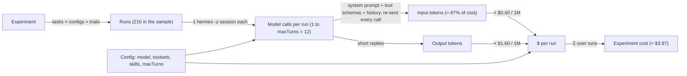

# What one pipeline run costs

How much it costs to run an experiment in Agent Eval Lab, worked out from the code.

> **Note.** Every dollar figure below is an **estimate**. It uses the app's own token assumptions and the prices in `configs/*.yaml`. Your real bill depends on how many tokens Hermes actually sends. Compare it with actual spend after a real run (see [See actual spend](#6-see-and-control-spend)).

Related docs: [DESIGN.md](DESIGN.md) · [KNOWN_LIMITATIONS.md](KNOWN_LIMITATIONS.md)

---

## 1. TL;DR

Assumptions, from the code:

- Model: `gpt-4.1-mini` for all three configs (`configs/baseline.yaml`, `open-book.yaml`, `mapping-skill.yaml`).
- Price: $0.40 per 1M input tokens, $1.60 per 1M output tokens (`price:` in each config YAML).
- Tokens per run: 40,000 input and 1,500 output (`ESTIMATE_INPUT_TOKENS_PER_RUN` and `ESTIMATE_OUTPUT_TOKENS_PER_RUN` in `apps/api/src/pipeline/steps/2-plan.ts`).
- Suite: `indian-criminal-law` has 24 tasks (`suites/indian-criminal-law/suite.yaml`).

| What | Runs | Estimated cost |
|---|---:|---:|
| One run (one task, one config, one trial) | 1 | **$0.0184** (about 2 cents) |
| One task × one config, 3 trials | 3 | $0.055 |
| One config over the whole suite, 3 trials (24 × 3) | 72 | $1.32 |
| Full sample experiment (24 tasks × 3 configs × 3 trials) | 216 | **$3.97** |
| CI gate: `pnpm eval:ci --configs baseline,open-book --trials 3` (24 × 2 × 3) | 144 | **$2.65** |

The $3.97 matches the plan step's output for the sample experiment: `estimatedCostUsd: 3.9744` in `data/experiments/<id>/2-plan.json`.

Arithmetic for one run:

```
input : 40,000 × $0.40 / 1,000,000 = $0.0160
output:  1,500 × $1.60 / 1,000,000 = $0.0024
total                              = $0.0184
```

Then multiply by the number of runs: `$0.0184 × 216 = $3.9744` and `$0.0184 × 144 = $2.6496`.

Input tokens are 87% of the cost ($0.0160 of $0.0184). That is the number to watch.

---

## 2. The formula

The app computes the actual cost of each run in `apps/api/src/pipeline/steps/4-execute.ts`:

```
run cost = (input_tokens × inputPerMTok + output_tokens × outputPerMTok) / 1,000,000
```

It prefers Hermes' own figure when the session export has one (`actual_cost_usd`, then `estimated_cost_usd`; see `apps/api/src/infrastructure/hermes/hermes-session.ts`). It falls back to the formula above with the config's prices. Each run records which one it used in `costSource` (`hermes` or `estimated`).

Experiment cost is the sum over all runs:

```
experiment cost = Σ over runs (input_tokens × in_price + output_tokens × out_price) / 1e6
runs            = tasks × configs × trials
```

Step 5 (`5-score.ts`) copies `costUsd`, `inputTokens`, `outputTokens` and `apiCalls` into each run's score. Step 6 (`6-compare.ts`) reports the mean cost per config.

### Why input tokens dominate and grow

One run is one `hermes -z` session. A session makes one or more **model calls**. Every call re-sends:

1. Hermes' system prompt (large).
2. The JSON schemas of every enabled tool.
3. The whole conversation so far: the task prompt, earlier tool calls and their results.

The model only writes a short reply each time, so input is far bigger than output.

Input grows with each call. If the fixed part (system prompt + tool schemas) is `S` tokens and each tool round adds about `h` tokens of history, a run with `N` model calls sends roughly:

```
input ≈ N × S + h × (0 + 1 + … + (N−1)) = N × S + h × N(N−1)/2
```

Worked example. The numbers `S = 13,000` and `h = 2,000` are **illustrative**; Hermes' real prompt size has not been measured here.

| Config | Typical calls | Input tokens | Input cost |
|---|---:|---|---:|
| baseline (answers straight away) | 1 | 13,000 | $0.0052 |
| mapping-skill (loads the skill, then answers) | 2 | 2 × 13,000 + 2,000 = 28,000 | $0.0112 |
| open-book (search, read, then answer) | 4 | 4 × 13,000 + 2,000 × 6 = 64,000 | $0.0256 |

So `open-book` costs more per run. It has more tools (bigger `S`), makes more calls (bigger `N`), and tool results (pieces of `bns-2023.txt`) make `h` large. The plan step does not model this: it uses a flat 40,000 input tokens for every config. Treat its estimate as an average, not a per-config forecast.

---

## 3. What drives cost



---

## 4. Sensitivity

All rows change one thing from the sample (24 tasks, 3 configs, 3 trials, `gpt-4.1-mini`) and use the plan step's 40,000 / 1,500 tokens per run unless stated.

Model prices are standard-tier OpenAI list prices, **checked on 2026-10-25** at <https://developers.openai.com/api/docs/pricing>. They match the prices in `configs/*.yaml` for `gpt-4.1-mini`.

| Model | Input / cached input / output ($ per 1M) |
|---|---|
| gpt-4.1 | 2.00 / 0.50 / 8.00 |
| gpt-4.1-mini | 0.40 / 0.10 / 1.60 |
| gpt-4.1-nano | 0.10 / 0.025 / 0.40 |
| gpt-4o-mini | 0.15 / 0.075 / 0.60 |

| Change | Arithmetic | Per run | 216-run experiment | 144-run CI gate |
|---|---|---:|---:|---:|
| **Sample (gpt-4.1-mini)** | 0.0160 + 0.0024 | $0.0184 | $3.97 | $2.65 |
| Switch to gpt-4.1 | 40k × 2.00 + 1.5k × 8.00 | $0.0920 | $19.87 | $13.25 |
| Switch to gpt-4o-mini | 40k × 0.15 + 1.5k × 0.60 | $0.0069 | $1.49 | $0.99 |
| Switch to gpt-4.1-nano | 40k × 0.10 + 1.5k × 0.40 | $0.0046 | $0.99 | $0.66 |
| Trials = 1 | 24 × 3 × 1 = 72 runs | $0.0184 | $1.32 (72 runs) | $0.88 (48 runs) |
| Trials = 5 | 24 × 3 × 5 = 360 runs | $0.0184 | $6.62 (360 runs) | $4.42 (240 runs) |
| More tasks: +1 task | 3 configs × 3 trials = 9 runs | $0.0184 | +$0.17 per task | +$0.11 per task |
| More tasks: 100 tasks | 100 × 3 × 3 = 900 runs | $0.0184 | $16.56 (900 runs) | $11.04 (600 runs) |
| Prompt caching, 75% of input cached | 40k × (0.25 × 0.40 + 0.75 × 0.10) + 0.0024 | $0.0094 | $2.03 | $1.35 |
| Every run hits maxTurns = 12 (ceiling) | 12 × 13k + 2k × 66 = 288k in, ~3.6k out | $0.121 | ≈ $26 | ≈ $17 |
| maxTurns = 6, every run hits it | 6 × 13k + 2k × 15 = 108k in, ~1.8k out | $0.046 | ≈ $10 | ≈ $6.60 |

Notes on the table:

- **maxTurns** caps calls per run, so it caps cost. It does not change a run that finishes in 2 calls. The two maxTurns rows use the illustrative `S = 13,000`, `h = 2,000` from section 2. They show a worst case, not a typical case.
- **Prompt caching.** OpenAI discounts repeated prompt prefixes (the system prompt and tool schemas are the same every call). The share actually cached is unknown here; 75% is an assumption. The app's fallback formula does **not** apply the cached price, so if Hermes does not report its own cost, the app will overstate spend when caching happens.
- Cost scales linearly with runs. Halve the runs, halve the bill.

---

## 5. The simulated agent and other costs

**The simulated agent costs $0.** `apps/api/simulator/simulated-hermes.mjs` is a fake `hermes` CLI. It never calls a model. It invents plausible token counts so the cost columns have something to show:

- input: 34,000 + up to 12,000 random (gpt-4.1-mini), so about 34k–46k per run
- output: 350 + up to 700 random, so about 350–1,050 per run

Those fake tokens are priced with the config prices. The sample simulated experiment in `data/experiments/` shows "what a real run would cost" of **$3.56** (`spentUsd` in `status.json`), close to the plan's $3.97. Per config it averaged:

| Config | Mean input tokens | Mean output tokens | Mean $ per run | 72 runs |
|---|---:|---:|---:|---:|
| baseline | 37,663 | 688 | $0.0162 | $1.16 |
| open-book | 38,869 | 704 | $0.0167 | $1.20 |
| mapping-skill | 38,973 | 639 | $0.0166 | $1.20 |

These are made-up numbers. They do not show the extra calls open-book makes in real life. Nothing is billed. The web UI shows Spend as **$0** for simulated experiments, and the CLI prints "Simulated: nothing billed (a real run would cost ≈ $…)".

**Other costs: none.** Everything else runs locally: the Node API and web app, Python for Hermes, the scoring and stats. There is no hosted service, database or paid tool in the pipeline. The only bill is the OpenAI API, paid with your `OPENAI_API_KEY`.

---

## 6. See and control spend

### See it

- **Before a run:** the New run page shows the plan estimate (runs and ≈ $) as you pick suite, configs and trials. It uses the same 40,000 / 1,500 formula as step 2.
- **During and after a run:** the **Spend** card on the experiment page shows the running total (`spentUsd`), with the estimate as a hint. It updates as each run finishes.
- **Per run and per config:** the CSV and JSON export buttons on the experiment page include `costUsd`, `inputTokens`, `outputTokens` and `apiCalls` for every run. Step 6 also reports mean cost per config.
- **Files:** `data/experiments/<id>/status.json` (`estimatedCostUsd`, `spentUsd`) and `2-plan.json` (`estimatedCostUsd`).
- **The source of truth** is your OpenAI usage dashboard. Compare it with the app's Spend after the first real run.

### Control it

- **Fewer trials.** `--trials 1` costs a third of `--trials 3`. Use 1 for smoke tests, 3+ when you need a verdict.
- **Fewer configs.** Only compare the configs you care about, e.g. `--configs baseline,open-book` (144 runs instead of 216).
- **Fewer tasks.** A smaller suite for quick checks; the full suite for decisions.
- **Lower `maxTurns`** in the config YAML. It caps the worst-case calls per run.
- **Timeouts.** Each task has `timeoutSec` (default 240). A stuck run is killed, which stops it spending.
- **Cheaper model.** gpt-4o-mini or gpt-4.1-nano cut the bill by about 2.7× and 4× ($1.49 and $0.99 vs $3.97). Update `price:` in the YAML too, or the app's estimates will be wrong.
- **Try it free first.** Run the simulated agent (`--demo`) to check the setup before spending anything.

---

## 7. Caveats

- **Token numbers are typical values.** Real usage varies with the model, the task and how many tool calls the agent makes.
- **40,000 input tokens is a guess.** It is a flat constant in `2-plan.ts`. It ignores config differences. Real Hermes prompt and tool-schema sizes have not been measured.
- **open-book will likely cost more** than baseline per run, because it makes more calls and reads file content. The estimate does not show this.
- **Prices live in YAML.** The app uses the `price:` block of each config, not a live price list. If OpenAI changes prices, update the YAML. Prices above were checked on 2026-10-25.
- **Caching is not modelled** in the fallback cost formula, so cached tokens are charged at the full input price.
- **Retries and failed runs.** A run that fails part-way may still have spent tokens. A timed-out run's partial cost depends on what Hermes recorded.
- **Hermes' own cost field** is used when present. How Hermes 0.15.2 computes it has not been checked.

See [KNOWN_LIMITATIONS.md](KNOWN_LIMITATIONS.md) for other limits and [DESIGN.md](DESIGN.md) for how the pipeline steps fit together.
