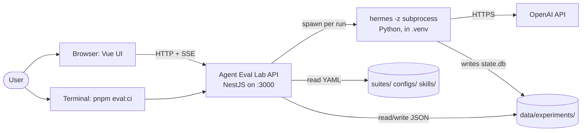
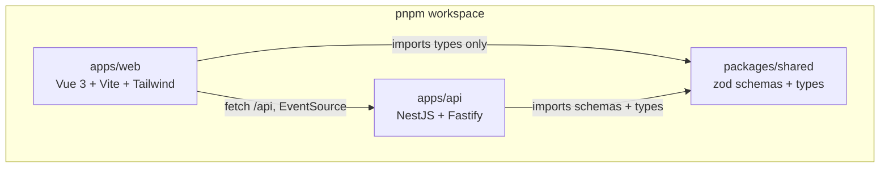
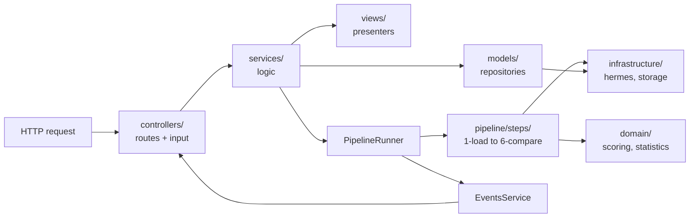
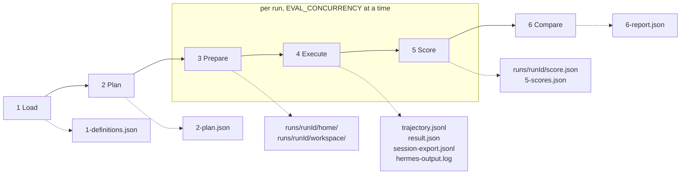
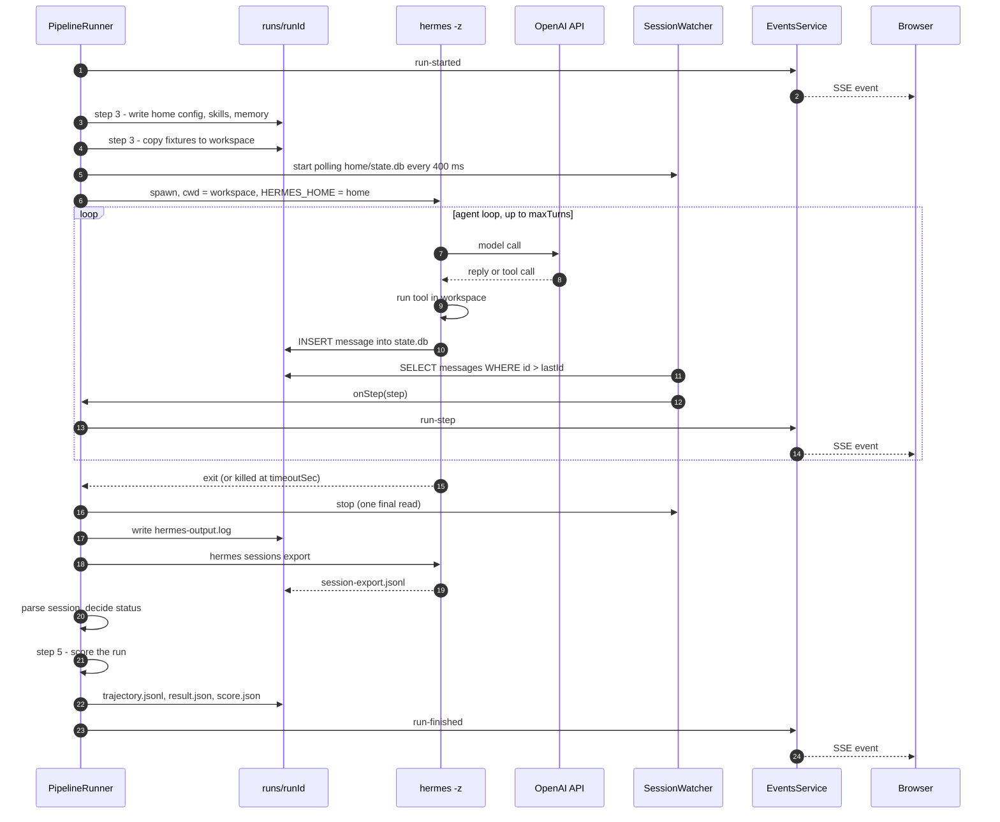
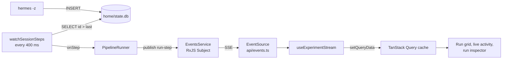
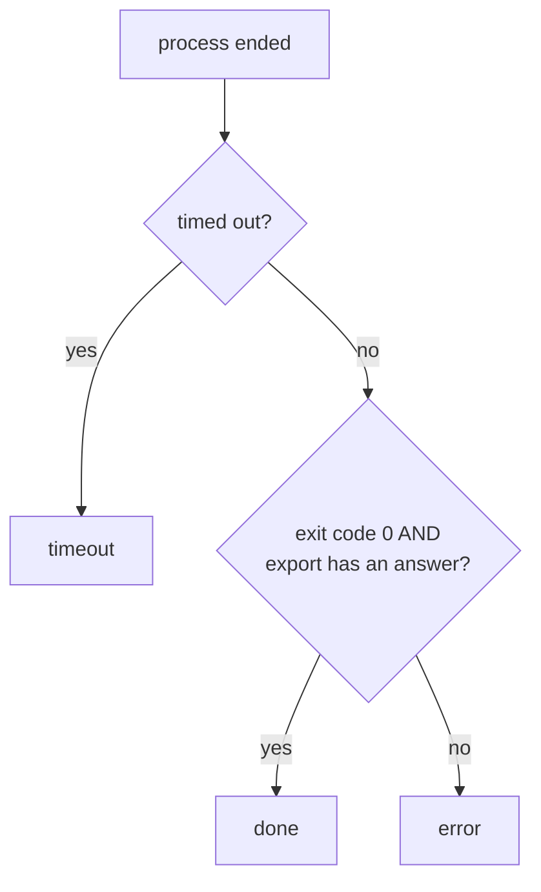
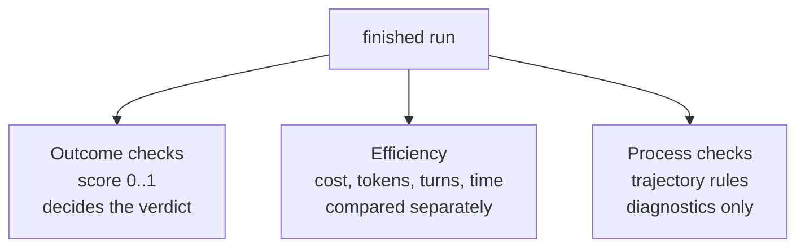
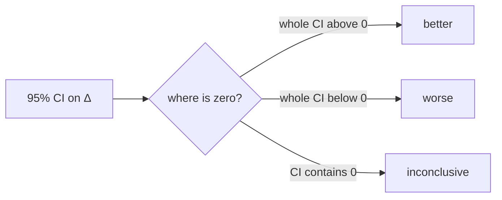
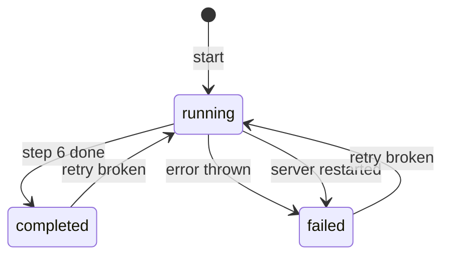

# Agent Eval Lab: Design

This document explains how Agent Eval Lab is built and why. It is written for someone learning the codebase. Every claim here was checked against the code. Where a file is the source of truth, it is named.

Related docs:

| Doc | What it covers |
|---|---|
| [`docs/README.md`](README.md) | Getting started: install, first run |
| [`docs/GUIDE.md`](GUIDE.md) | Function-by-function walkthrough and how-to recipes |
| [`docs/KNOWN_LIMITATIONS.md`](KNOWN_LIMITATIONS.md) | What doesn't work yet, and the sharp edges |
| [`docs/COSTS.md`](COSTS.md) | What a real run costs and how cost is measured |
| [`docs/architecture.md`](architecture.md) | Layer rules (who may import whom) |
| [`docs/ASSUMPTIONS.md`](ASSUMPTIONS.md) | Every assumption, and what changes if it is wrong |

---

## Contents

1. [Purpose, goals and non-goals](#1-purpose-goals-and-non-goals)
2. [System context](#2-system-context)
3. [Containers and components](#3-containers-and-components)
4. [The 6-step pipeline](#4-the-6-step-pipeline)
5. [One run, end to end](#5-one-run-end-to-end)
6. [Data model and on-disk layout](#6-data-model-and-on-disk-layout)
7. [Scoring and statistics](#7-scoring-and-statistics)
8. [Isolation, safety and recovery](#8-isolation-safety-and-recovery)
9. [The simulated agent](#9-the-simulated-agent)
10. [Key decisions and trade-offs](#10-key-decisions-and-trade-offs)

---

## 1. Purpose, goals and non-goals

**The question it answers:** when you change an agent's model, add a skill, or give it tools, did it get better, worse, or stay the same? And how sure can you be?

Agents are random. The same task can pass once and fail the next time. So one run proves nothing. Agent Eval Lab runs each task several times under each configuration, scores every run against a known answer, and uses a paired bootstrap to separate a real change from luck.

The agent under test is [Hermes Agent](https://github.com/NousResearch/hermes-agent) **v0.15.2** (Nous Research), pinned in `scripts/start.mjs`. Hermes calls the OpenAI API directly. The key lives in `.env` as `OPENAI_API_KEY`.

### Goals

| Goal | How it is met |
|---|---|
| Trustworthy verdicts | Paired bootstrap, 95% CI, verdict = better / worse / inconclusive |
| Exact, explainable scoring | Code compares answers to expected values. No AI judge. Every mismatch is explained. |
| Fair runs | Each run gets a private Hermes home and a fresh copy of its input files |
| Transparency | Every pipeline step writes a JSON file you can open |
| Watch it happen | Agent steps stream live to the browser over SSE |
| Debuggable failures | Run inspector: trajectory, check-by-check explanations, workspace files |
| Usable in CI | `pnpm eval:ci` exits 1 on a *worse* verdict |
| Runs with no key | A simulated agent runs the full pipeline for $0 |
| One command | `pnpm start` installs Hermes, builds, and serves on `:3000` |

### Non-goals

- Scoring live production traffic.
- LLM-as-judge or persona testing. Tasks have exact answers.
- Memory that carries between runs ("learning over time"). It breaks run independence.
- Multi-user use, login, annotation queues.
- Editing tasks or configs in the UI. YAML in git is the source.
- Sandboxing untrusted content. Tasks and fixtures are trusted repo files.

---

## 2. System context

Everything runs on one machine. The user talks to one Node process. That process spawns Hermes as a child process per run. Hermes is the only part that talks to the internet.



| Actor | Role |
|---|---|
| User | Picks a suite and configs, starts runs, reads results |
| Browser UI | Vue 3 single-page app, served by the same process as the API |
| API | NestJS (Fastify adapter). Runs the pipeline, serves results and the built UI |
| Hermes subprocess | One per run. Runs the agent loop, executes tools in the run's workspace |
| OpenAI API | The model. Called only by Hermes, never by the API itself |
| Filesystem | Definitions (YAML, read-only) and experiment output (`data/`, gitignored) |

The server binds to `127.0.0.1` only (`apps/api/src/main.ts`).

---

## 3. Containers and components

### 3.1 The monorepo

A pnpm workspace with three packages.



| Package | Contents |
|---|---|
| `packages/shared` | `definitions.ts`: zod schemas for suites, tasks, checks, configs. `api-types.ts`: every file shape and API response. |
| `apps/api` | Backend, pipeline, CLI (`src/cli.ts`), and the simulated agent (`simulator/`). |
| `apps/web` | Frontend. Built into `apps/web/dist`, which the API serves. |
| `suites/`, `configs/`, `skills/` | The definitions (YAML and markdown). Not a package. |
| `scripts/start.mjs` | What `pnpm start` does: install deps, create `.venv`, install Hermes, build, serve. |

### 3.2 The API: MVC plus a pipeline

The backend uses MVC. The pipeline and the pure rules sit beside it.



| Layer | Files | Job |
|---|---|---|
| Controllers | `definitions`, `experiments`, `runs`, `health` | Routes and input validation only |
| DTO | `dto/create-experiment.dto.ts` | zod schema for the start/estimate body |
| Services | `experiments`, `runs`, `definitions`, `pipeline-runner`, `events` | Business logic. No HTTP objects. |
| Models | `experiment.repository.ts`, `definitions.repository.ts` | The only code that persists results |
| Views | `experiment`, `run`, `definitions`, `export` | Pure functions: stored data to API shape or CSV |
| Pipeline | `pipeline/steps/1-load.ts` … `6-compare.ts` | One file per step |
| Domain | `domain/scoring/`, `domain/statistics/bootstrap.ts` | Pure rules, no I/O, unit-tested |
| Infrastructure | `infrastructure/hermes/`, `infrastructure/storage/` | Spawn Hermes, parse its export, tail its DB, JSON files |
| Config | `config/paths.ts`, `env.ts`, `model-provider.ts` | Paths, `.env` loading, provider name |

**One writer rule.** Pipeline steps return data. `PipelineRunner` saves it through `ExperimentRepository`. Two exceptions: step 3 creates the run folders, and step 4 writes its raw `hermes-output.log` and `session-export.jsonl`.

### 3.3 HTTP API

| Method and path | Purpose |
|---|---|
| `GET /api/health` | Key configured? Hermes installed? Which version? |
| `GET /api/definitions` | Suites, configs, and validation errors |
| `POST /api/estimate` | Run count and rough cost (steps 1 and 2 only) |
| `POST /api/experiments` | Start an experiment |
| `GET /api/experiments` | List experiments, newest first |
| `GET /api/experiments/:id` | Status plus per-run status |
| `GET /api/experiments/:id/report` | The step 6 report |
| `POST /api/experiments/:id/retry-broken` | Re-run timeouts and errors |
| `GET /api/experiments/:id/export?format=csv\|json` | Download all run scores |
| `GET /api/experiments/:id/events` | Live events (Server-Sent Events) |
| `GET /api/experiments/:id/runs/:runId` | Run inspector data |
| `GET /api/experiments/:id/runs/:runId/file?path=` | One workspace file (max 100,000 chars) |

Any other path serves the built UI, with `index.html` as the fallback for client-side routes.

### 3.4 The web app: feature folders

```
apps/web/src/
├── main.ts, App.vue          entry and shell
├── router/index.ts           all routes
├── api/                      typed fetch client, SSE subscribe, query keys
├── composables/              useExperimentStream (live events), useTheme
├── components/               shared presentational parts
│   ├── layout/               AppShell, SidebarNav, EnvironmentStatus, ThemeToggle
│   ├── ui/                   badges, cards, icons, page header
│   ├── charts/ForestPlot.vue
│   ├── pipeline/PipelineFlow.vue
│   └── run/                  TimelineItem, ScoringPanel, trajectory.logic.ts
├── features/                 one folder per page
│   ├── experiments/          overview and experiment list
│   ├── new-run/              launch form + CLI equivalent
│   ├── experiment-detail/    results table, task diff, run grid, live activity
│   ├── run-inspector/        one run: trajectory + why it scored so
│   ├── run-compare/          two runs side by side
│   └── definitions/          tasks and configs
├── utils/                    format.ts, activity.ts (pure helpers)
└── styles/main.css           theme tokens (light + dark)
```

Every feature folder has the same three layers:

| File | Layer | Rule |
|---|---|---|
| `<Feature>Page.vue` | Composition | Wires the composable to components |
| `components/*.vue` | UI | Props in, events out. No fetching. |
| `composables/use<Feature>.ts` | Functional | TanStack Query and state |
| `<feature>.logic.ts` | Domain | Pure functions, unit-tested |

Routes: `/` (overview), `/new`, `/definitions`, `/experiments/:id`, `/experiments/:id/runs/:runId`, `/experiments/:id/compare/:left/:right`.

---

## 4. The 6-step pipeline

The whole app is one pipeline. Each step does one job and writes its result to `data/experiments/<id>/`. Steps 3 to 5 run once per run, two at a time by default (`EVAL_CONCURRENCY`).



| Step | File | What it does | Writes |
|---|---|---|---|
| 1 Load | `1-load.ts` | Parse YAML, validate with zod, cross-check (unique task ids, fixture folders, skill files, memory file). Freeze the suite, configs, skill text and memory text. | `1-definitions.json` |
| 2 Plan | `2-plan.ts` | List every task × config × trial. Order is trial, then task, then config, so configs interleave over time. Estimate cost. | `2-plan.json` |
| 3 Prepare | `3-prepare.ts` | Create the run's private `home/` (Hermes `config.yaml`, skills, memory) and copy fixtures into `workspace/`. | `runs/<runId>/home/`, `workspace/` |
| 4 Execute | `4-execute.ts` | Run `hermes -z`, stream steps live, then `hermes sessions export`. Decide `done` / `timeout` / `error`. | `trajectory.jsonl`, `result.json`, `session-export.jsonl`, `hermes-output.log` |
| 5 Score | `5-score.ts` | Outcome checks (the score), efficiency metrics, process flags. | `runs/<runId>/score.json` |
| 6 Compare | `6-compare.ts` | Paired bootstrap for score, cost and duration vs the baseline. Task diffs, pass^k, flaky tasks, trials-to-resolve. | `6-report.json` |

`5-scores.json` (all run scores in one array) is written by `PipelineRunner.finish()` just before step 6, so it is complete even after a retry.

**Run ids** are `<task>__<config>__t<trial>`, e.g. `map-ipc-302__mapping-skill__t2` (`runIdFor()` in `2-plan.ts`).

**Cost estimate.** Step 2 assumes 40,000 input and 1,500 output tokens per run, times the config's `price`. It is deliberately rough: Hermes re-sends a large system prompt and tool schemas on every model call. The real cost is recorded per run. See [`COSTS.md`](COSTS.md).

**Progress.** `status.json` holds `currentStep`, `runsTotal`, `runsFinished`, `estimatedCostUsd` and `spentUsd`. Every update is saved to disk and also published as a `status` event.

`PipelineRunner` (`services/pipeline-runner.service.ts`) is the orchestrator:

| Method | Does |
|---|---|
| `start()` | Write the initial `status.json`, then run steps 1 to 6 in the background |
| `executeRuns()` | Steps 3 to 5 per run, with a small concurrency limiter |
| `finish()` | Collect scores, write `5-scores.json` and `6-report.json`, mark completed |
| `retryBroken()` | Re-run only broken runs, then `finish()` again |
| `recoverInterrupted()` | On server start, mark leftover `running` experiments as `failed` |
| `waitFor()` | Await an experiment (used by the CLI) |

---

## 5. One run, end to end

This is what happens for a single run, from an empty folder to a score on screen.



### 5.1 The two Hermes calls

```bash
# 1. Run the task headless. -z auto-approves tools and prints only the final answer.
HERMES_HOME=runs/<runId>/home \
  hermes -z "<task prompt>" -m <model> --provider openai-api -t <toolsets>
# cwd = runs/<runId>/workspace; timeout = task.timeoutSec (default 240)

# 2. Export the full conversation, tokens and cost from the session store.
HERMES_HOME=runs/<runId>/home hermes sessions export runs/<runId>/session-export.jsonl
# timeout = 30 s; runs even after a timeout, to keep a partial trajectory
```

How each config field reaches Hermes:

| Config field | Reaches Hermes as |
|---|---|
| `model` | `-m <model>` and `model.default` in `config.yaml` |
| `toolsets` | `-t a,b,c` |
| `skills` | `home/skills/<name>/SKILL.md`, copied from the frozen snapshot |
| `memory` | `home/memories/MEMORY.md` (`---` separators converted to Hermes's `§`). Memory is off when unset. |
| `maxTurns` | `agent.max_turns` in `config.yaml` |
| `price` | Not passed. Used only for estimates and as a cost fallback. |

The provider is always `openai-api` (`config/model-provider.ts`).

### 5.2 Live streaming

Hermes 0.15.2's `-z` mode prints only the final answer. It has no streaming output flag. But Hermes writes each message to `HERMES_HOME/state.db` (SQLite) as the agent loop runs. So we tail that database.



- **Watcher** (`infrastructure/hermes/session-watcher.ts`): opens the DB read-only with `node:sqlite`, reads rows with `id > lastId`, and turns each into a `TrajectoryStep`. Errors (table not yet created, a write lock) are ignored until the next tick. Stopping does one final read.
- **Event bus** (`services/events.service.ts`): one in-process RxJS `Subject`. The SSE stream filters by experiment id and adds a `ping` every 15 s so proxies keep the connection open.
- **Events** (`ExperimentEvent` in `packages/shared/src/api-types.ts`): `status`, `run-started`, `run-step`, `run-finished`.
- **UI** (`composables/useExperimentStream.ts`): patches the query cache directly, keeps the last 40 activity items, and announces finished runs through an `aria-live` region.
- **Fallback.** Queries still poll while an experiment runs (experiment detail every 4 s, list every 1.5 s, an unscored run every 2 s). `EventSource` also reconnects by itself.
- **Granularity** is one message (a model reply or a tool result), not token by token.

The live trajectory is for watching only. The stored `trajectory.jsonl` comes from the session export, which also adds the system prompt as step 0.

### 5.3 Deciding the run's status



The final answer is the last non-empty assistant message in the export. Cost is Hermes's `actual_cost_usd`, else `estimated_cost_usd`, else tokens × the config's `price`. `result.json` records which source was used (`costSource: hermes | estimated`).

---

## 6. Data model and on-disk layout

### 6.1 Inputs (in git)

```
suites/<suite>/suite.yaml       tasks: prompt, fixtures, checks, processChecks
suites/<suite>/fixtures/...     files copied into each run's workspace
configs/<id>.yaml               model, toolsets, skills, memory, maxTurns, price
skills/<name>/SKILL.md          skills a config can install
```

Sample: `suites/indian-criminal-law` (24 tasks on the BNS 2023), and configs `baseline`, `open-book`, `mapping-skill`.

### 6.2 Outputs (gitignored)

```
data/experiments/<experimentId>/
├── status.json               live progress (PipelineRunner)
├── 1-definitions.json        step 1: frozen suite, configs, skill + memory text
├── 2-plan.json               step 2: every run + cost estimate
├── runs/
│   └── <task>__<config>__t<trial>/
│       ├── home/             step 3: private HERMES_HOME
│       │   ├── config.yaml
│       │   ├── skills/<name>/SKILL.md     (if the config has skills)
│       │   ├── memories/MEMORY.md         (if the config seeds memory)
│       │   └── state.db                   written by Hermes
│       ├── workspace/        step 3: fixture copy; the agent works here
│       ├── hermes-output.log step 4: command, exit code, stdout, stderr
│       ├── session-export.jsonl  step 4: raw Hermes export
│       ├── trajectory.jsonl  step 4: one TrajectoryStep per line
│       ├── result.json       step 4: status, answer, tokens, cost, time
│       └── score.json        step 5: checks, metrics, process flags
├── 5-scores.json             all RunScores in one array
└── 6-report.json             step 6: verdicts, task diffs, reliability
```

Experiment ids are a timestamp plus a random suffix, e.g. `2026-10-25T11-32-55-974d`. JSON files are written atomically (temp file, then rename) in `infrastructure/storage/json-store.ts`, so a reader never sees half a file.

### 6.3 Key types

All in `packages/shared/src/`. Inputs are zod schemas in `definitions.ts`; outputs are interfaces in `api-types.ts`.

| Type | File on disk | Key fields |
|---|---|---|
| `Task` | in `suite.yaml` | `id`, `prompt`, `fixtures`, `timeoutSec` (240), `passThreshold` (1), `checks`, `processChecks` |
| `AgentConfig` | `configs/*.yaml` | `id`, `model`, `toolsets`, `skills`, `memory` (null = off), `maxTurns` (20), `price` |
| `ExperimentStatusFile` | `status.json` | `status`, `currentStep`, `runsTotal`, `runsFinished`, `agent` (`hermes` / `simulated`), `retries`, `error` |
| `DefinitionsSnapshot` | `1-definitions.json` | `suite`, `configs`, `skills` (name → text), `memories` (path → text) |
| `PlanFile` | `2-plan.json` | `runs: PlannedRun[]` (`runId`, `taskId`, `configId`, `trial`), `estimatedCostUsd` |
| `TrajectoryStep` | `trajectory.jsonl` | `seq`, `role`, `content`, `toolCalls`, `toolName`, `reasoning` |
| `RunResult` | `result.json` | `status` (`done` / `timeout` / `error`), `finalAnswer`, tokens, `costUsd`, `costSource`, `apiCalls`, `error` |
| `RunScore` | `score.json` | `score` (0..1), `passed`, `outcomeChecks`, `metrics`, `processFlags` |
| `Report` | `6-report.json` | `configs` (summaries), `comparisons` (per candidate), `tasks` (grid), `method` |
| `ExperimentEvent` | SSE only | `status`, `run-started`, `run-step`, `run-finished` |

Defaults in parentheses come from the zod schemas.

---

## 7. Scoring and statistics

### 7.1 Three scoring layers

Only the first layer decides the verdict.



**Why separate layers?** A blended score (say 70% accuracy, 30% cost) hides trade-offs. "More accurate but pricier" and "cheaper but sloppier" could get the same number. Separate layers let the report say "better accuracy, 2× cost", and a human decides.

### 7.2 Outcome checks

Code in `domain/scoring/outcome-checks.ts` and `matching.ts`.

| Check | Looks at | Scores |
|---|---|---|
| `answer_contains` | Final answer text | 1 if it contains `value`, else 0 |
| `answer_json` | Last JSON object in the final answer | Fraction of expected top-level fields that match |
| `file_json` | A JSON file the agent wrote in its workspace | Fraction of expected top-level fields that match |

- **Run score** = mean of its checks. **Passed** = status `done` and score ≥ `passThreshold` (default 1).
- **Fair matching:** strings ignore case and extra whitespace. Numbers accept numeric strings (`"3"`, `"1,234"`, `"12%"`) and an absolute `tolerance`. Expected objects are subsets. Arrays must match in order.
- **Explained:** each mismatch reads like `$.section: expected 103, got 302`.
- **Safe paths:** `file_json` refuses paths that escape the workspace.
- **Broken runs** (`timeout`, `error`) score 0 and every check says "Not checked: run timeout (…)". The status is kept, so "wrong answer" and "broken run" stay distinct.

### 7.3 Efficiency

Copied from `result.json` into `score.json`: `costUsd`, `durationMs`, `apiCalls`, `inputTokens`, `outputTokens`. Step 6 compares cost and duration with the same bootstrap as the score, but separately.

### 7.4 Process checks (diagnostics only)

Code in `domain/scoring/process-checks.ts`. They never change the score.

| Check | Warns when |
|---|---|
| `read_inputs` | No tool call mentions any fixture file name. The agent may have guessed. |
| `used_skill` | The config installed skills but `skill_view` was never called for them |
| `tool_errors` | A tool result starts with "error" or is JSON with `success: false` or an `error` string |
| `hit_turn_limit` | `apiCalls ≥ maxTurns`. It was probably cut off. |

Default per task: `read_inputs`, `tool_errors`, `hit_turn_limit`.

### 7.5 The paired bootstrap

Code in `domain/statistics/bootstrap.ts`. The question: is the candidate config better than the baseline on the same tasks?

1. **Pair by task.** For each task, collect the baseline's trial scores and the candidate's trial scores. Tasks missing either side are dropped.
2. **Observed Δ** = mean over tasks of the candidate mean, minus the same for the baseline.
3. **Resample 10,000 times.** Each iteration picks tasks at random with replacement. For each picked task it also resamples that task's trials, for both configs. It records the Δ.
4. **CI** = the 2.5th and 97.5th percentiles of those 10,000 Δ values (interpolated).
5. **Seed 42** (mulberry32 PRNG), so the same data always gives the same report.

The two levels (tasks, then trials) capture both kinds of noise: which tasks happen to be in the suite, and how random the agent is per task.



For cost and duration, lower is better, so the labels flip (`verdictFromInterval(..., higherIsBetter: false)`). A CI of exactly [0, 0] (no difference at all) is inconclusive.

**Inconclusive is an honest answer.** It means "with this much data, we can't rule out no difference."

### 7.6 Reliability and diffs in the report

Built in `pipeline/steps/6-compare.ts`:

| Field | Meaning |
|---|---|
| `passAllRate` (pass^k) | Share of tasks where every trial passed |
| `flakyTasks` | Tasks with some trials passing and some failing |
| `brokenRuns` | Runs that timed out or errored |
| `taskDiffs` | Per task: baseline mean, candidate mean, Δ, and `improved` / `regressed` / `unchanged`. Descriptive only. |
| `trialsToResolve` | Only for inconclusive score verdicts. Rough estimate: `ceil(n × (halfWidth / abs(Δ))²)`. At least n+1. Null if Δ ≈ 0 or the answer exceeds 30. |

`trialsToResolve` assumes the CI shrinks with 1/√n. That only models trial noise, not task-to-task variation, so the UI labels it rough.

---

## 8. Isolation, safety and recovery

### 8.1 Isolation per run

Hermes is built to remember things and learn skills. In a test, that means run 1 could change run 2. Each run is therefore sealed off:

| Mechanism | Where | Effect |
|---|---|---|
| Private `HERMES_HOME` | `3-prepare.ts`, `4-execute.ts` | Config, memory, skills, session DB and logs all live in `runs/<runId>/home/`. `~/.hermes` is never read or written. |
| Fresh workspace copy | `3-prepare.ts` | Fixtures are copied, not linked. Agent edits can't leak. |
| Frozen definitions | `1-load.ts` | Skill and memory text come from `1-definitions.json`, not live files |
| Clean environment | `hermesEnv()` in `4-execute.ts` | Removes every `HERMES_*` variable and `OPENROUTER_API_KEY` from the inherited env, then sets `HERMES_HOME` and `OPENAI_API_KEY` |
| Memory off unless seeded | `hermesConfigYaml()` | `memory_enabled: false` and `user_profile_enabled: false` |

Fixture files are read from the repo at run time (not frozen). Don't edit them while an experiment runs.

### 8.2 Safety caps

| Cap | Value | Enforced by |
|---|---|---|
| Turn limit | `maxTurns` (default 20) | Hermes, via `agent.max_turns` in `config.yaml` |
| Run timeout | `timeoutSec` per task (default 240) | `runProcess()` sends `SIGKILL` to the whole process group |
| Export timeout | 30 s | `runProcess()` |
| Concurrency | `EVAL_CONCURRENCY` (default 2) | `runWithConcurrency()` |
| Trials | 1 to 20 | Request DTO |

Hermes is spawned `detached`, in its own process group. One kill reaches Hermes and any tool subprocesses it started.

**Trusted content only.** Hermes's terminal tool runs on your machine (`terminal.backend: local`), inside the workspace folder. That folder is not a sandbox. The sample tasks are safe because they are ours.

**The API key** is passed to Hermes as an environment variable. The platform never writes it to disk.

### 8.3 Gotcha: exit code 0 on API failure

`hermes -z` exits with code 0 even when the model API call fails. It just prints an error like "API call failed … Connection error". So exit code alone is not enough. A run is `done` only if the process exited 0 **and** the exported session contains a non-empty assistant answer. Anything else is `error`, with the last 2,000 characters of output saved as the reason.

### 8.4 Recovery and retry

There is no job queue to survive a crash. The work lives in a promise inside the Node process.

- **On server start**, `recoverInterrupted()` finds any experiment still marked `running` and marks it `failed`, with the message: "Interrupted: the server stopped while this experiment was running. Use "Retry broken" to finish it."
- **Retry broken** (`POST /api/experiments/:id/retry-broken`, or the button in the experiment header):
  1. A run is broken if it has no `score.json`, or its status is not `done`.
  2. Those run folders are deleted, then re-run through steps 3 to 5.
  3. `finish()` rebuilds `5-scores.json` and `6-report.json` from all runs.
  4. `retries` is incremented. The simulated agent gets a new attempt number, so it draws fresh randomness.
- Successful runs are kept. A retried experiment mixes runs from two points in time. That is fine for infrastructure failures.
- Retry is refused while running, when no runs are broken, or when the experiment never got past planning.



---

## 9. The simulated agent

`apps/api/simulator/simulated-hermes.mjs` is a stand-in for the `hermes` CLI. It makes no model calls and costs nothing. It accepts the same arguments (`-z`, `-m`, `-t`, and `sessions export <file>`), so the pipeline doesn't know the difference.

How it answers:

1. Finds the task by matching the prompt against `suites/*/suite.yaml`.
2. Sets a chance of answering correctly: 0.4 for a `mini` model, 0.6 otherwise.
3. With the `file` toolset and `bns-2023.txt` in the workspace, it "searches the Act" (a real `search_files` tool step) and rises to 0.9.
4. For `map-*` and `now-*` tasks, if `ipc-bns-mapping` is installed in `HERMES_HOME`, it "loads the skill" (`skill_view`) and rises to at least 0.93.
5. Wrong answers look real: the repealed IPC number, `code: "IPC"`, or a near miss.
6. Writes a session file in `HERMES_HOME` that `sessions export` returns, with the same fields as real Hermes.

| Mode | Set by | Behaviour |
|---|---|---|
| Deterministic (default) | Tests | Likely events always happen. Same input, same output. No live steps. |
| Demo | `SIMULATED_HERMES_MODE=demo` (UI "Simulated", `pnpm demo`) | Seeded randomness per run folder and attempt. About 3% of runs fake an API failure. Messages are inserted into `state.db` one by one, so they stream live. |

Test hooks: a prompt containing `SLEEP` hangs forever (timeout test). One containing `CRASH` exits with code 3 (error test).

**How tests use it.** `apps/api/src/pipeline/pipeline.test.ts` runs steps 1 to 6 on slices of the real sample suite with the simulator. It asserts that file tools fix every question, that the mapping skill fixes only IPC to BNS questions, and that hung and crashing runs become `timeout` and `error`. `session-watcher.test.ts` checks that each message is emitted once, in order, including ones written just before stop. No test needs an API key.

**Labelling.** Simulated experiments are stored with `agent: "simulated"` and shown as SIMULATED in the UI, the CLI and exports. A retry of a simulated experiment stays simulated.

---

## 10. Key decisions and trade-offs

| Decision | Why | Trade-off |
|---|---|---|
| **Files, not a database** | Every step's output is a JSON file you can open. No setup, ORM or migrations. Fast enough for hundreds of runs. | No queries across experiments. Listing reads every `status.json`. |
| **In-process work, no job queue** | Simple. One user, one machine. | A server restart interrupts running experiments. They are marked failed and finished with "Retry broken". |
| **Fastify, not Express** | The corporate npm proxy blocks `content-type` and `content-disposition`, which Express and `@fastify/static` need. | The built UI is served by about 20 lines of our own code in `main.ts`. |
| **`hermes -z` + `sessions export`** | 0.15.2 on PyPI lacks the documented `--format stream-json`. These two commands give the same trajectory, plus tokens and cost. | Only `4-execute.ts` and `hermes-session.ts` change if Hermes adds streaming. |
| **Tail `state.db` for live steps** | `-z` prints only the final answer. SQLite WAL allows a concurrent reader. | Depends on Hermes's `messages` table shape. Step-level, not token-level. |
| **SSE, not WebSockets** | One-way server-to-browser is all we need. `EventSource` reconnects by itself. | Polling stays as a fallback. |
| **Exact checks, no LLM judge** | Tasks have right answers. A judge adds cost and its own randomness. | Open-ended tasks aren't supported yet. |
| **Partial credit per JSON field** | A half-right answer is better than a wrong one. | Pass/fail still needs every field by default (`passThreshold: 1`). |
| **Paired, two-level bootstrap** | Pairing by task removes task difficulty from the comparison. Two levels capture task and trial noise. | 10,000 iterations per metric per candidate. Fast at this size. |
| **Fixed seed (42)** | Reports are reproducible. | None in practice. |
| **Cost and time compared separately** | Keeps trade-offs visible. | The user weighs them, not the tool. |
| **Seeded memory only** | Runs must be independent for the statistics to hold. | "Learning over time" is out of scope. |
| **Pinned Hermes in a local `.venv`** | Results stay comparable. Your global Python is untouched. | Upgrading means changing `HERMES_VERSION` and re-running parser tests. |
| **Local terminal backend** | No Docker needed. | Only trusted tasks and fixtures. |
| **Shared zod schemas** | One definition validates YAML and types both apps. | The web app imports types only. Shared is built as CommonJS for the API. |
| **No ESLint** | Its dependency tree is blocked by the same npm proxy. | TypeScript strict and Prettier are the guardrails. |

For what is still missing or fragile, see [`KNOWN_LIMITATIONS.md`](KNOWN_LIMITATIONS.md). For money, see [`COSTS.md`](COSTS.md). To get started, see [`README.md`](README.md). For a function-level tour, see [`GUIDE.md`](GUIDE.md).
