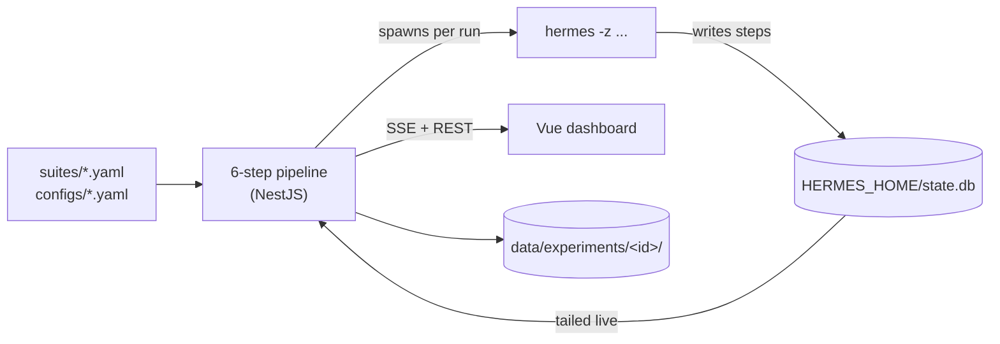
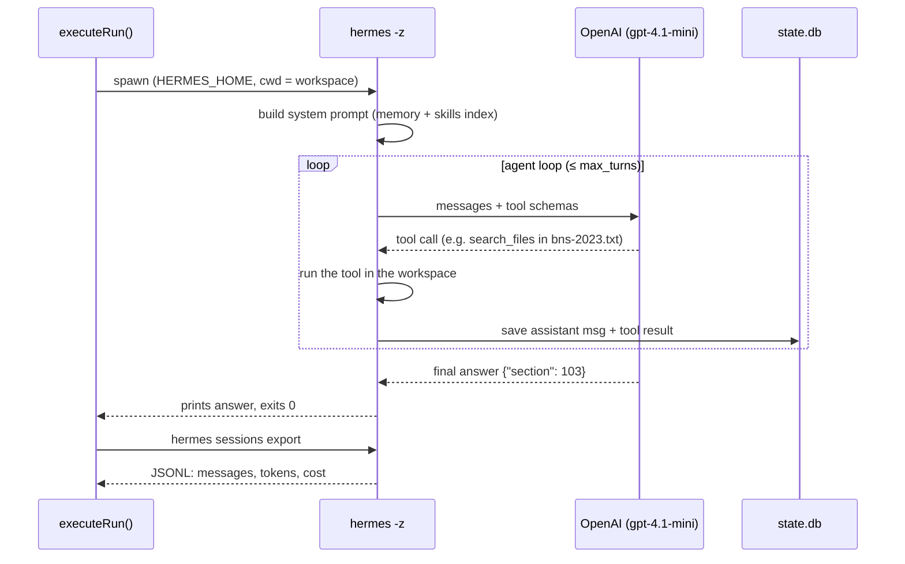
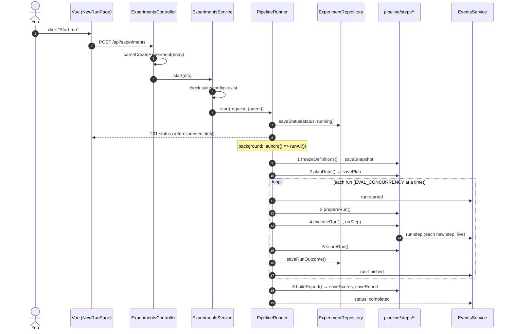
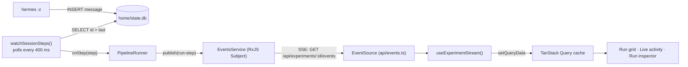

# Agent Eval Lab: the complete guide

This guide explains how the project works from the inside: how Hermes is used, how the code is organised, and **which function runs when**. It includes worked examples and sample code throughout.

> Companion docs: [`DESIGN.md`](DESIGN.md) (why it is built this way), [`architecture.md`](architecture.md) (layer rules), [`ASSUMPTIONS.md`](ASSUMPTIONS.md).

## Contents
1. [The idea in one minute](#1-the-idea-in-one-minute)
2. [How Hermes Agent is used](#2-how-hermes-agent-is-used)
3. [Project structure](#3-project-structure)
4. [The life of an experiment: which function runs when](#4-the-life-of-an-experiment-which-function-runs-when)
5. [Live streaming: how steps reach the browser](#5-live-streaming-how-steps-reach-the-browser)
6. [Scoring a run, with an example](#6-scoring-a-run-with-an-example)
7. [The statistics, with an example](#7-the-statistics-with-an-example)
8. [The files on disk](#8-the-files-on-disk)
9. [The frontend](#9-the-frontend)
10. [How-to recipes (with code)](#10-how-to-recipes-with-code)
11. [Running, testing, debugging](#11-running-testing-debugging)
12. [Cheat sheet: function index](#12-cheat-sheet-function-index)
13. [Configs and tools, line by line](#13-configs-and-tools-line-by-line)
14. [Where correct answers live and how they're checked](#14-where-correct-answers-live-and-how-theyre-checked)
15. [The Indian criminal law suite](#15-the-indian-criminal-law-suite)

---

## 1. The idea in one minute

You change your agent: a new model, a skill, some memory. Did it get **better**? Agents are random, so one try proves nothing. This app:

1. runs **every task × every config × N trials** with the real Hermes agent,
2. **scores** each run against known answers,
3. **compares** each config with a baseline using a paired bootstrap, which gives *better*, *worse* or *inconclusive* with a 95% confidence interval,
4. lets you **inspect** any run step by step, **live**, as the agent works.



---

## 2. How Hermes Agent is used

**Hermes is the system under test.** We never reimplement it. Every run starts the real `hermes` CLI as a separate process, exactly as a user would, and records what it did.

### 2.1 One run = one private Hermes

Hermes keeps its brain in a folder called `HERMES_HOME`: config, memory, skills and a SQLite session store. Each run gets **its own** home, so one run can never influence another:

```
data/experiments/<id>/runs/sec-murder__open-book__t1/
├── home/                     ← HERMES_HOME for this run only
│   ├── config.yaml           written by step 3 (model, turn limit, memory on/off)
│   ├── memories/MEMORY.md    only if the config seeds memory (no sample config does)
│   ├── skills/<name>/SKILL.md  only the config's skills
│   └── state.db              Hermes's own session database (it writes this)
└── workspace/                copy of the task's input files; Hermes runs here (cwd)
```

Example `home/config.yaml`, generated by `hermesConfigYaml()` in `pipeline/steps/3-prepare.ts`:

```yaml
model:
  default: gpt-4.1-mini
  provider: openai-api        # Hermes's built-in OpenAI provider (reads OPENAI_API_KEY)
agent:
  max_turns: 12               # cap on agent-loop iterations
memory:
  memory_enabled: false       # true only when the config has a memory seed
  user_profile_enabled: false
terminal:
  backend: local
  cwd: .                      # = the run's workspace
```

### 2.2 The two CLI calls per run

`executeRun()` in `pipeline/steps/4-execute.ts` makes exactly two calls:

```bash
# 1) Run the task headless. -z (oneshot) auto-approves tools and prints only the final answer.
HERMES_HOME=runs/<runId>/home  OPENAI_API_KEY=sk-...  \
  hermes -z "Under the Bharatiya Nyaya Sanhita, 2023, which section prescribes the punishment for murder? ..." \
         -m gpt-4.1-mini --provider openai-api -t skills,file,terminal
#    (process cwd = runs/<runId>/workspace)

# 2) Export what happened: every message, tool call, tool result, tokens, cost.
HERMES_HOME=runs/<runId>/home  hermes sessions export runs/<runId>/session-export.jsonl
```

Why two calls? In Hermes 0.15.2, `-z` prints only the final answer, but Hermes saves the whole conversation in `state.db`. Because each run has its own home, that database holds exactly **one** session, which is this run.

What the agent sees inside Hermes:



### 2.3 How config differences reach Hermes

| Config field | How it reaches Hermes | Code |
|---|---|---|
| `model` | `-m <model>` and `config.yaml: model.default` | `executeRun`, `hermesConfigYaml` |
| `toolsets` | `-t skills` (`baseline`) or `-t skills,file,terminal` (`open-book`) | `executeRun` |
| `skills` | `home/skills/<name>/SKILL.md` is copied in (e.g. `ipc-bns-mapping` for `mapping-skill`). Hermes lists it in the skills index, and the agent loads it with the `skill_view` tool | `prepareRun` |
| `memory` | `home/memories/MEMORY.md` is written and `memory_enabled: true` is set. Hermes injects it into the system prompt. None of the sample configs set it | `prepareRun`, `toHermesMemory` |
| `maxTurns` | `config.yaml: agent.max_turns` | `hermesConfigYaml` |

### 2.4 Turning the export into a trajectory

`parseSession()` in `infrastructure/hermes/hermes-session.ts` converts the export into our `TrajectoryStep[]`, plus metrics. One exported message:

```json
{ "role": "assistant", "content": "", "tool_calls": "[{\"id\":\"call_1\",\"function\":{\"name\":\"search_files\",\"arguments\":\"{\\\"path\\\":\\\"bns-2023.txt\\\"}\"}}]", "timestamp": 1792919092.0 }
```

becomes (via `toTrajectoryStep()`):

```json
{ "seq": 2, "role": "assistant", "content": "", "toolCalls": [{ "id": "call_1", "name": "search_files", "arguments": "{\"path\":\"bns-2023.txt\"}" }], "toolName": null, "toolCallId": null, "reasoning": null, "timestamp": 1792919092 }
```

### 2.5 Deciding the outcome of a run

`hermes -z` **exits with code 0 even when the model API fails**. So `executeRun` decides the status like this:

```ts
if (proc.timedOut) status = 'timeout';                                   // killed after task.timeoutSec
else if (proc.exitCode !== 0 || !parsed?.finalAnswer) status = 'error';   // crash or no answer at all
else status = 'done';                                                    // → goes to scoring
```

### 2.6 The simulated agent

`apps/api/simulator/simulated-hermes.mjs` behaves like `hermes` (same two commands) but makes **no model calls**. It is used by the tests and by `pnpm demo` / the "Simulated" option in the UI. In demo mode it writes its messages into a real `state.db` one at a time, so live streaming works exactly as it does with real Hermes. Simulated experiments are labelled **SIMULATED** everywhere.

---

## 3. Project structure

```
hermes/
├── apps/
│   ├── api/                         NestJS backend (MVC) + the pipeline
│   │   ├── src/
│   │   │   ├── main.ts              HTTP server (API + built UI on :3000)
│   │   │   ├── cli.ts               `pnpm eval:ci` / `pnpm demo`
│   │   │   ├── app.module.ts        wires controllers + services + models
│   │   │   ├── controllers/         C: HTTP routes only
│   │   │   ├── services/            business logic (+ PipelineRunner, EventsService)
│   │   │   ├── models/              M: repositories (the only code touching storage)
│   │   │   ├── views/               V: models → API responses / CSV
│   │   │   ├── dto/                 request validation (zod)
│   │   │   ├── pipeline/steps/      1-load … 6-compare (one file per step)
│   │   │   ├── domain/              scoring + statistics (pure functions)
│   │   │   ├── infrastructure/      hermes/ (process, session, watcher), storage/
│   │   │   └── config/              paths, env, model provider
│   │   └── simulator/simulated-hermes.mjs
│   └── web/                         Vue 3 dashboard
│       └── src/
│           ├── api/                 fetch client, SSE client, query keys
│           ├── composables/         useTheme, useExperimentStream (shared state)
│           ├── components/          layout/, ui/, charts/, pipeline/, run/
│           ├── features/<feature>/  Page + components + composables + logic
│           ├── router/  styles/  utils/
├── packages/shared/                 zod schemas + types used by both apps
├── suites/indian-criminal-law/      the sample suite (suite.yaml + fixtures/statute/bns-2023.txt)
├── configs/                         sample agent configs: baseline, open-book, mapping-skill
├── skills/                          skills used by configs (ipc-bns-mapping)
├── scripts/start.mjs                what `pnpm start` does
└── data/experiments/                everything the pipeline writes (gitignored)
```

**Rule of thumb:** to find where something happens, ask "which layer?" HTTP goes in `controllers/`, decisions in `services/`, reading and writing files in `models/`, response shapes in `views/`, and pipeline behaviour in `pipeline/steps/`.

---

## 4. The life of an experiment: which function runs when

### 4.1 Overview



### 4.2 Step by step, with the exact functions

| # | When | Function (file) | What it does | Writes |
|---|---|---|---|---|
| 0 | `POST /api/experiments` | `ExperimentsController.create` → `parseCreateExperiment` (`dto/`) → `ExperimentsService.start` → `PipelineRunner.start` | validate, create the id, save the initial status, start in the background | `status.json` |
| 1 | first thing in `runAll` | `DefinitionsRepository.snapshot` → `loadDefinitions` + `freezeDefinitions` (`steps/1-load.ts`) | read and validate YAML, freeze the task/config/skill/memory text | `1-definitions.json` |
| 2 | next | `planRuns` (`steps/2-plan.ts`) | tasks × configs × trials, cost estimate | `2-plan.json` |
| 3 | per run | `prepareRun` (`steps/3-prepare.ts`) | create `home/` and `workspace/`, write `config.yaml`, skills, memory, copy fixtures | `runs/<id>/home`, `workspace` |
| 4 | per run | `executeRun` (`steps/4-execute.ts`) → `runProcess` + `watchSessionSteps` + `parseSession` | run Hermes, stream steps, export the session, decide the status | `hermes-output.log`, `session-export.jsonl` |
| 5 | per run | `scoreRun` (`steps/5-score.ts`) → `runOutcomeCheck`, `runProcessCheck` | score the three layers | (returned) |
| – | per run | `ExperimentRepository.saveRunOutcome` | persist the run | `trajectory.jsonl`, `result.json`, `score.json` |
| 6 | at the end | `finish` → `buildReport` (`steps/6-compare.ts`) → `pairedBootstrap` | collect the scores and compare | `5-scores.json`, `6-report.json` |

### 4.3 Reading results (no pipeline involved)

| UI action | Request | Function chain |
|---|---|---|
| Open the Overview | `GET /api/experiments` | `ExperimentsController.list` → `ExperimentsService.list` → `ExperimentRepository.listStatuses` |
| Open an experiment | `GET /api/experiments/:id` | `…detail` → `ExperimentsService.detail` → `findPlan`, `findRunScore` → `toExperimentDetail` (view) |
| See the verdicts | `GET /api/experiments/:id/report` | `…report` → `ExperimentRepository.findReport` |
| Click a run chip | `GET /api/experiments/:id/runs/:runId` | `RunsController.detail` → `RunsService.detail` → `findRunResult`/`findRunScore`/`findTrajectory`/`listWorkspace` → `toRunDetail` |
| Download CSV | `GET …/export?format=csv` | `ExperimentsService.export` → `toExportFile` (view) |
| Retry broken runs | `POST …/retry-broken` | `PipelineRunner.retryBroken` → `deleteRun` → `executeRuns` → `finish` |
| Watch live | `GET …/events` (SSE) | `ExperimentsController.stream` → `EventsService.stream` |

### 4.4 On server start

```ts
// main.ts
loadEnv();                                                 // .env → process.env
const app = await NestFactory.create(AppModule, new FastifyAdapter());
await app.get(PipelineRunner).recoverInterrupted();        // "running" leftovers → failed (retryable)
serveWebApp(app);                                          // built Vue app on the same port
await app.listen(3000, '127.0.0.1');
```

### 4.5 From the terminal (CI)

`pnpm eval:ci --suite indian-criminal-law --configs baseline,mapping-skill --trials 3` runs `cli.ts`. It uses the **same** `PipelineRunner`: `start()` → `waitFor()` → read the report → exit 1 if any verdict is *worse*.

---

## 5. Live streaming: how steps reach the browser

Hermes writes each message to `state.db` **while** the agent loop runs. SQLite's WAL mode allows a reader at the same time. So we tail that database and push new rows to the browser.



The watcher (`infrastructure/hermes/session-watcher.ts`), simplified:

```ts
export function watchSessionSteps(dbPath: string, onStep: (s: TrajectoryStep) => void, intervalMs = 400) {
  let db: DatabaseSync | null = null;
  let lastId = 0;
  let seq = 1;
  const read = () => {
    if (!db && existsSync(dbPath)) db = new DatabaseSync(dbPath, { readOnly: true });
    const rows = db?.prepare('SELECT ... FROM messages WHERE id > ? ORDER BY id').all(lastId) ?? [];
    for (const row of rows) { lastId = row.id; onStep(toTrajectoryStep(row, seq++)); }
  };
  const timer = setInterval(read, intervalMs);
  return () => { clearInterval(timer); read(); db?.close(); };   // final read on stop
}
```

The event types (`packages/shared/src/api-types.ts`):

```ts
type ExperimentEvent =
  | { type: 'status'; status: ExperimentStatusFile }                               // progress bar, stage strip
  | { type: 'run-started'; runId; taskId; configId; trial }                        // chip → "running"
  | { type: 'run-step'; runId; step: TrajectoryStep }                              // activity feed, inspector timeline
  | { type: 'run-finished'; runId; runStatus; score; passed };                     // chip → score
```

What the wire looks like (`curl -N localhost:3000/api/experiments/<id>/events`):

```
data: {"type":"run-step","runId":"sec-murder__open-book__t1","step":{"seq":2,"role":"assistant","toolCalls":[{"name":"search_files",...}],...}}

data: {"type":"run-finished","runId":"sec-murder__open-book__t1","runStatus":"done","score":1,"passed":true}
```

How the UI applies an event (`composables/useExperimentStream.ts`), with no refetch needed:

```ts
case 'run-finished':
  queryClient.setQueryData<ExperimentDetail>(queryKeys.experiment(id), (old) =>
    old && { ...old, runs: old.runs.map((r) => (r.runId === event.runId ? { ...r, status: event.runStatus, score: event.score } : r)) });
```

Notes:
- **Granularity is one step**: each model message or tool result. Hermes 0.15.2's `-z` mode doesn't expose token-by-token output.
- Polling still runs every 4 s while an experiment is running, as a fallback if the stream drops. `EventSource` also reconnects by itself.
- Run finishes are announced to screen readers through an `aria-live` region.

---

## 6. Scoring a run, with an example

Task (from `suites/indian-criminal-law/suite.yaml`):

```yaml
- id: now-murder-2025
  prompt: >-
    A murder was committed in Delhi on 15 August 2025. Under which criminal code and section is the
    punishment prescribed? ... Reply with ONLY a JSON object: {"code": string, "section": number}
  fixtures: fixtures/statute
  checks:
    - id: code
      type: answer_json
      expect: { code: BNS }
    - id: section
      type: answer_json
      expect: { section: 103 }
  processChecks: [used_skill, tool_errors, hit_turn_limit]
```

Agent's final answer (config `baseline`): `Murder is punished under {"code": "IPC", "section": 302}` (it used the repealed IPC).

`scoreRun()` produces three layers:

```json
{
  "score": 0, "passed": false, "runStatus": "done",
  "outcomeChecks": [
    { "id": "code", "type": "answer_json", "score": 0, "passed": false,
      "explanation": "$.code: expected \"BNS\", got \"IPC\"" },
    { "id": "section", "type": "answer_json", "score": 0, "passed": false,
      "explanation": "$.section: expected 103, got 302" }
  ],
  "metrics": { "costUsd": 0.0146, "durationMs": 4100, "apiCalls": 1, "inputTokens": 34200, "outputTokens": 380 },
  "processFlags": [
    { "id": "used_skill", "ok": true, "explanation": "No skills installed in this config." },
    { "id": "tool_errors", "ok": true, "explanation": "No failing tool calls." },
    { "id": "hit_turn_limit", "ok": true, "explanation": "Used 1 of 12 allowed turns." }
  ]
}
```

How the matching works (`domain/scoring/`):
- `extractJsonObject(answer)` finds the **last** valid `{...}` in the text, so prose around the JSON is fine.
- `deepMatch(actual, expected, tolerance)` ignores case and extra spaces in strings, accepts numbers within `±tolerance`, and treats expected objects as subsets.
- Partial credit: the score is the average of the checks, so `{"code": "BNS", "section": 302}` gets one of the two right and scores **0.5**.

Only **layer 1** (outcome) affects the score. Cost and time are compared separately, and process flags only explain failures.

---

## 7. The statistics, with an example

Two configs, three tasks, two trials each:

| task | baseline trials | mapping-skill trials | baseline mean | mapping-skill mean | Δ |
|---|---|---|---|---|---|
| sec-murder | 1, 1 | 1, 1 | 1.0 | 1.0 | 0.0 |
| map-ipc-302 | 0, 0 | 1, 1 | 0.0 | 1.0 | **+1.0** |
| pun-theft | 0, 0 | 0, 0 | 0.0 | 0.0 | 0.0 |

Observed **Δ = (0 + 1 + 0) / 3 = +0.33**.

`pairedBootstrap()` (`domain/statistics/bootstrap.ts`) then asks how much Δ could move with different tasks or another run of the trials:

```ts
for (let it = 0; it < 10_000; it++) {
  let sum = 0;
  for (let k = 0; k < tasks.length; k++) {
    const task = tasks[Math.floor(rng() * tasks.length)];               // 1) re-pick a task
    sum += resampleMean(task.candidate, rng) - resampleMean(task.baseline, rng); // 2) re-pick its trials
  }
  deltas[it] = sum / tasks.length;
}
// sort → 2.5th and 97.5th percentiles = 95% CI
```

In about 30% of resamples `map-ipc-302` isn't picked at all (Δ = 0), so the CI comes out around **[0.00, +1.00]**. The lower bound isn't **above** zero, so `verdictFromInterval()` returns **inconclusive**. That's honest: a skill that helps one task out of three hasn't been shown to help the suite. The **task diff** shows exactly where it helped (`map-ipc-302 ▲ +1.00`).

```ts
verdictFromInterval(ciLow, ciHigh, higherIsBetter = true):
  ciLow  > 0 → better
  ciHigh < 0 → worse
  otherwise  → inconclusive
```

Extras in `buildReport()`:
- **pass^k**: the share of tasks where *every* trial passed.
- **flaky**: tasks where trials disagree.
- **trialsToResolve**: `trials × (CI half-width / |Δ|)²`, shown as a rough "≈N trials might settle this".

---

## 8. The files on disk

Everything for one experiment lives in `data/experiments/<id>/`. You can `cat` any of it.

| File | Written by | Example content |
|---|---|---|
| `status.json` | `PipelineRunner` (every progress change) | `{"status":"running","currentStep":"execute","runsFinished":17,"runsTotal":216,...}` |
| `1-definitions.json` | step 1 | frozen suite, configs and skill text (and memory text, if a config seeds it) |
| `2-plan.json` | step 2 | `{"runs":[{"runId":"sec-murder__baseline__t1",...}],"estimatedCostUsd":1.05}` |
| `runs/<runId>/trajectory.jsonl` | repository (after step 4) | one `TrajectoryStep` per line |
| `runs/<runId>/result.json` | repository | status, final answer, tokens, cost, duration |
| `runs/<runId>/score.json` | repository (after step 5) | the three scoring layers (see §6) |
| `runs/<runId>/hermes-output.log` | step 4 | the exact command, exit code, stdout, stderr |
| `5-scores.json` | end of step 5 (`PipelineRunner.finish`) | every run's score |
| `6-report.json` | step 6 | configs, comparisons (Δ, CI, verdict, task diffs), task rows |

A run id is `<task>__<config>__t<trial>`, for example `map-ipc-302__mapping-skill__t2` (from `runIdFor()`).

---

## 9. The frontend

### 9.1 Layers in every feature

```
features/experiment-detail/
├── ExperimentDetailPage.vue       composes: calls composables, passes props to components
├── composables/useExperimentDetail.ts   TanStack Query: GET experiment, GET report, retry mutation
├── components/*.vue               presentational: props in, events out
├── experimentDetail.logic.ts      pure functions (stepStates, diffRows, forestRows…)
└── experimentDetail.logic.test.ts
```

Example flow on the experiment page:

```ts
// ExperimentDetailPage.vue
const { detail, report, retryBroken } = useExperimentDetail(id);       // REST data
const running = computed(() => detail.data.value?.status.status === 'running');
const { connected, activity, announcement } = useExperimentStream(id, running);  // SSE, only while running
const rows = computed(() => diffRows(report.data.value!, candidate.value, filter.value)); // pure logic
```

```vue
<ForestPlot :rows="forestRows(report)" :caption="verdictSummary(report)" />
<TaskDiffTable :rows="rows" :counts="counts" @set-filter="(f) => (filter = f)" />
<LiveActivity :items="activity" :connected="connected" />
```

### 9.2 Shared pieces

| Piece | Where | Purpose |
|---|---|---|
| `AppShell` | `components/layout/` | skip link, sidebar (desktop) / drawer (mobile), `<main id="main">` |
| `PageHeader`, `PanelCard`, `StatCard` | `components/ui/` | consistent headings, sections, KPI tiles |
| `ForestPlot` | `components/charts/` | Δ + CI per config on one axis (verdict shown as text + icon) |
| `useTheme` | `composables/` | light/dark with persistence (pre-paint script in `index.html`) |
| `useExperimentStream` | `composables/` | SSE → cache updates + activity feed + `aria-live` text |
| `queryKeys` | `api/queryKeys.ts` | one source of truth for cache keys |

### 9.3 Accessibility built in
- **Navigation:** a skip link, landmarks (`nav`, `main`, `aside`), breadcrumbs, `aria-current` on the active page, and focus moves to `<main>` on every route change.
- **Tables:** captions, `scope` on headers, and real links or buttons inside cells instead of clickable rows.
- **Colour:** status is never shown by colour alone (▲ ▼ ≈ ✓ ✗ plus text). Every text token pair meets ≥ 4.5:1.
- **Live updates:** run finishes and the latest inspector step are announced through `aria-live="polite"`.
- **Motion:** respects `prefers-reduced-motion`.
- **Verified:** axe-core reports **0 WCAG 2.2 AA violations** on every page in both themes.

---

## 10. How-to recipes (with code)

### 10.1 Add a task

```yaml
# suites/indian-criminal-law/suite.yaml  (under "Punishments")
- id: pun-snatching # illustrative new task; BNS 304(2): up to 3 years
  prompt: >-
    Under the Bharatiya Nyaya Sanhita, 2023, what is the maximum imprisonment, in years, for snatching?
    If you can read files, the full Act is in bns-2023.txt in your working directory.
    Reply with ONLY a JSON object: {"maxYears": number}
  fixtures: fixtures/statute             # the shared Act text
  checks:
    - id: max-years
      type: answer_json
      expect: { maxYears: 3 }
  processChecks: [tool_errors, hit_turn_limit]
```

Check every expected answer against `fixtures/statute/bns-2023.txt` and name the section in a comment.

The UI's Tasks & configs page validates it immediately. A wrong field shows up as an error with the file name.

### 10.2 Add a config

```yaml
# configs/open-book-skill.yaml
id: open-book-skill
description: Open book plus the IPC → BNS mapping skill.
model: gpt-4.1-mini
toolsets: [skills, file, terminal]
skills: [ipc-bns-mapping]
maxTurns: 12
price: { inputPerMTok: 0.40, outputPerMTok: 1.60 }
```

### 10.3 Add a new check type (example: `answer_regex`)

1. The schema, in `packages/shared/src/definitions.ts`:

```ts
const answerRegexCheck = z.object({
  type: z.literal('answer_regex'),
  id: z.string().optional(),
  pattern: z.string().min(1),
});
export const outcomeCheckSchema = z.discriminatedUnion('type', [answerContainsCheck, answerJsonCheck, fileJsonCheck, answerRegexCheck]);
```

2. The scorer, in `apps/api/src/domain/scoring/outcome-checks.ts`, as a new `case` in `runOutcomeCheck`:

```ts
case 'answer_regex': {
  const ok = new RegExp(check.pattern, 'i').test(ctx.finalAnswer);
  return result(check, index, ok ? 1 : 0, ok ? `Answer matches /${check.pattern}/.` : `Answer does not match /${check.pattern}/.`);
}
```

3. A test, in `domain/scoring/checks.test.ts`:

```ts
it('answer_regex', async () => {
  const r = await runOutcomeCheck({ type: 'answer_regex', pattern: 'EMEA' }, 0, { finalAnswer: 'emea', workspaceDir: workspace });
  expect(r.passed).toBe(true);
});
```

4. Optional: describe it in the UI by adding a case to `describeCheck()` in `features/definitions/definitions.logic.ts`.

### 10.4 Add an API endpoint the MVC way (example: delete an experiment)

```ts
// models/experiment.repository.ts: storage
deleteExperiment(id: string): Promise<void> {
  return rm(experimentPaths(id).dir, { recursive: true, force: true });
}

// services/experiments.service.ts: rules
async remove(id: string): Promise<void> {
  const status = await this.requireStatus(id);
  if (status.status === 'running') throw new BadRequestException('Stop it first.');
  await this.experiments.deleteExperiment(id);
}

// controllers/experiments.controller.ts: HTTP only
@Delete(':id')
remove(@Param('id') id: string): Promise<void> {
  return this.experiments.remove(id);
}
```

Then add it to the web client:

```ts
// apps/web/src/api/index.ts
deleteExperiment: (id: string) => request<void>(`/api/experiments/${encodeURIComponent(id)}`, { method: 'DELETE' }),
```

### 10.5 Publish a new live event

```ts
// 1) packages/shared/src/api-types.ts
| { type: 'run-retrying'; runId: string }

// 2) where it happens (e.g. PipelineRunner.retryBroken)
this.events.publish(status.id, { type: 'run-retrying', runId: run.runId });

// 3) composables/useExperimentStream.ts: a new case in handle()
case 'run-retrying':
  patchRun(event.runId, { status: 'pending' });
  break;
```

### 10.6 Add a UI feature (pattern)

```
features/leaderboard/
├── LeaderboardPage.vue                 // route component
├── composables/useLeaderboard.ts       // useQuery({ queryKey: queryKeys.experiments, ... })
├── components/LeaderboardTable.vue     // props only
├── leaderboard.logic.ts                // rank(experiments) → rows   (pure)
└── leaderboard.logic.test.ts
```

Register the route in `router/index.ts` with `meta: { title: 'Leaderboard' }`, and add a nav item in `components/layout/SidebarNav.vue`.

---

## 11. Running, testing, debugging

```bash
pnpm start          # bootstrap (venv + Hermes) → build → http://localhost:3000
pnpm demo           # full experiment with the simulated agent (no key, $0)
pnpm eval:ci --suite indian-criminal-law --configs baseline,mapping-skill --trials 3   # CI gate
pnpm test           # API (40) + web (20) tests
pnpm typecheck
pnpm format
pnpm dev:api        # API on :3000      (rebuild + restart to pick up changes)
pnpm dev:web        # UI with hot reload on :5173 (proxies /api)
```

Debugging a run:

| Question | Look at |
|---|---|
| What exact command ran? | `runs/<runId>/hermes-output.log` |
| What did Hermes record? | `runs/<runId>/session-export.jsonl` (raw), `trajectory.jsonl` (parsed) |
| Why did it score 0? | `runs/<runId>/score.json`, then `outcomeChecks[].explanation` |
| What files did the agent write? | `runs/<runId>/workspace/` (the inspector shows added and modified files) |
| What memory or skills did it have? | `runs/<runId>/home/` and the system prompt at the top of the inspector timeline |
| Is the stream working? | `curl -N localhost:3000/api/experiments/<id>/events` |

Common problems:
- **"API call failed … Connection error"**: Hermes (Python) can't reach api.openai.com. Behind a corporate proxy, set `EVAL_CA_BUNDLE` in `.env`.
- **A run stays `error` after retry**: open its `hermes-output.log`. The error text is also in the inspector's "Run problem" box.
- **No live updates**: the stream only opens while an experiment is running. Check the SSE endpoint with curl.

---

## 12. Cheat sheet: function index

| Function | File | Called by | Purpose |
|---|---|---|---|
| `PipelineRunner.start` | services/pipeline-runner.service.ts | `ExperimentsService.start`, `cli.ts` | create the status, start `runAll` in the background |
| `PipelineRunner.runAll` (private) | ″ | `start` | steps 1 → 6 |
| `PipelineRunner.executeRuns` (private) | ″ | `runAll`, `retryBroken` | steps 3–5 per run, with concurrency; publishes run events |
| `PipelineRunner.finish` (private) | ″ | `runAll`, `retryBroken` | collect scores, `buildReport`, mark completed |
| `PipelineRunner.retryBroken` | ″ | `ExperimentsService.retryBroken` | re-run timeouts and errors only |
| `PipelineRunner.recoverInterrupted` | ″ | `main.ts` | fail leftover "running" experiments |
| `loadDefinitions` / `freezeDefinitions` | pipeline/steps/1-load.ts | `DefinitionsRepository` | read, validate and freeze YAML |
| `planRuns` | steps/2-plan.ts | runner, `DefinitionsService.estimate` | list runs + estimate |
| `prepareRun` / `hermesConfigYaml` | steps/3-prepare.ts | runner | build the private `HERMES_HOME` + workspace |
| `executeRun` | steps/4-execute.ts | runner | spawn Hermes, stream, export, decide status |
| `runProcess` | infrastructure/hermes/hermes-process.ts | `executeRun` | spawn with timeout + process-group kill |
| `watchSessionSteps` | infrastructure/hermes/session-watcher.ts | `executeRun` | tail `state.db` → `onStep` |
| `parseSession` / `toTrajectoryStep` | infrastructure/hermes/hermes-session.ts | `executeRun`, watcher | export → trajectory + metrics |
| `scoreRun` | steps/5-score.ts | runner | three scoring layers |
| `runOutcomeCheck` / `runProcessCheck` | domain/scoring/ | `scoreRun` | individual checks |
| `deepMatch` / `extractJsonObject` | domain/scoring/matching.ts | outcome checks | fair matching |
| `buildReport` | steps/6-compare.ts | runner | verdicts, task diffs, reliability |
| `pairedBootstrap` / `verdictFromInterval` | domain/statistics/bootstrap.ts | `buildReport` | CI and verdict |
| `EventsService.publish` / `.stream` | services/events.service.ts | runner / controller | live event bus → SSE |
| `toExperimentDetail` / `toRunDetail` / `toExportFile` | views/ | services | response shapes |
| `useExperimentStream` | web/src/composables/ | experiment + run pages | SSE → query cache |
| `useExperimentDetail` / `useRunInspector` / `useNewRun` | web/src/features/*/composables/ | pages | REST data + actions |

---

## 13. Configs and tools, line by line

A **config** (`configs/<id>.yaml`) is one version of the agent. Example: `configs/open-book.yaml`:

```yaml
# Baseline + file and terminal tools: the agent can search bns-2023.txt.
id: open-book
description: Open book. Same model; can read and search the BNS text.
model: gpt-4.1-mini
toolsets: [skills, file, terminal]
skills: []
maxTurns: 12
price: { inputPerMTok: 0.40, outputPerMTok: 1.60 }
```

What each line does:

| Line | Effect |
|---|---|
| `id` | unique name, part of every run id (`sec-murder__open-book__t1`) |
| `description` | shown in the UI |
| `model` | `hermes -m gpt-4.1-mini` and `config.yaml: model.default` |
| `toolsets` | `hermes -t skills,file,terminal` (the agent's tools) |
| `skills` | each one is copied to `home/skills/<name>/SKILL.md` |
| `memory` (not set here, so `null`) | a path writes `home/memories/MEMORY.md` and sets `memory_enabled`; `null` = off |
| `maxTurns` | `config.yaml: agent.max_turns` |
| `price` | our cost estimate only (not sent to Hermes) |

Where each line is validated and applied:

| Line | Validated by | Applied by |
|---|---|---|
| all | `agentConfigSchema` (packages/shared/src/definitions.ts), called from `loadDefinitions()` | — |
| `skills`, `memory` | `loadDefinitions()` checks the files exist | `prepareRun()` writes them into the run's `home/` |
| `model`, `maxTurns`, memory on/off | — | `hermesConfigYaml()` → `home/config.yaml` |
| `model`, `toolsets` | — | `executeRun()` → `hermes -z … -m … -t …` |

**Tools are Hermes toolsets.** We don't write tools; a config switches Hermes's built-in toolsets on:

| Toolset | Tools | Lets the agent |
|---|---|---|
| `file` | `read_file`, `write_file`, `patch`, `search_files` | open and search the input files |
| `terminal` | `terminal`, `process` | run shell commands (grep, python) |
| `skills` | `skills_list`, `skill_view`, `skill_manage` | find and load installed skills |
| `memory` | `memory` | read and write its memory |

So `baseline` (`toolsets: [skills]`) **cannot open `bns-2023.txt`**, even though the file is in its workspace. That's what makes closed-book vs open-book a fair, one-variable experiment.

## 14. Where correct answers live and how they're checked

The correct answer sits **next to the question**, in the task's `checks`:

```yaml
- id: now-murder-2025                       # suites/indian-criminal-law/suite.yaml
  prompt: >-
    A murder was committed in Delhi on 15 August 2025. Under which criminal code and section is the
    punishment prescribed? ... Reply with ONLY a JSON object: {"code": string, "section": number}
  checks:
    - id: code
      type: answer_json
      expect: { code: BNS }                 # ← correct answer, field 1
    - id: section
      type: answer_json
      expect: { section: 103 }              # ← correct answer, field 2 (verified: BNS s.103(1))
```

Checking is **automatic and exact**: no human compares strings and no AI judge is involved. After the run, `scoreRun()` calls `runOutcomeCheck()` for each check:

```
Agent answer:  "Under the old code it was 302, but now: {"code": "BNS", "section": 103}"
1. extractJsonObject()  → { code: "BNS", section: 103 }        (last JSON object in the text)
2. deepMatch(actual, { code: "BNS" })   → ✓   ("bns" would also pass: case-insensitive)
   deepMatch(actual, { section: 103 })  → ✓   ("103" as a string would also pass)
3. score = average of checks = 1.0 → passed
```

A stale answer `{"code": "IPC", "section": 302}` scores **0.0**, and the explanations say exactly why:
`$.code: expected "BNS", got "IPC"` and `$.section: expected 103, got 302`.

**Exact checks or an AI judge?**

| | Exact checks (what we use) | AI judge |
|---|---|---|
| Good for | one right answer: numbers, names, section ids | open-ended text: summaries, explanations |
| Cost | free | a model call per check |
| Same input → same score? | always | no (it's a model) |
| Can be talked into a wrong pass? | no | yes, sometimes |

The trick is to **ask for structured answers** (`{"section": 103}`), which turns a factual question into an exact check. Keep an AI judge for tasks where no single string is right, and store its reasoning so a human can audit it.

## 15. The Indian criminal law suite

`suites/indian-criminal-law/` has 24 tasks over the **Bharatiya Nyaya Sanhita, 2023** (BNS), which replaced the IPC on 1 July 2024:

| Kind | Count | Example | Tests |
|---|---|---|---|
| `sec-*` | 9 | "Which section defines organised crime?" → 111 | knowledge / retrieval |
| `pun-*` | 7 | "Max imprisonment for theft (first conviction)?" → 3 | precise recall |
| `map-*` | 6 | "IPC 420 was replaced by which BNS section?" → 318 | the IPC → BNS transition |
| `now-*` | 2 | "Murder in Aug 2025: which code and section?" → BNS 103 | not answering with repealed IPC numbers |

- **Source of truth:** the official Gazette text, shipped as `fixtures/statute/bns-2023.txt`. Every expected answer has a comment naming the BNS section it was checked against.
- **Configs:** three, all gpt-4.1-mini. Each candidate changes one thing vs `baseline` (closed book, `toolsets: [skills]`): `open-book` adds file and terminal tools so it can search the Act, and `mapping-skill` adds the skill `ipc-bns-mapping` (still closed book).

Run it:

```bash
pnpm demo   # simulated, $0: suite indian-criminal-law, configs baseline,open-book,mapping-skill, 3 trials
pnpm eval:ci --demo --suite indian-criminal-law --configs baseline,open-book,mapping-skill --trials 3   # the same, spelled out
# real Hermes (needs OPENAI_API_KEY): same without --demo, or use "New run" in the UI
```

The simulated agent answers right with a probability set by the config: 0.4 for the closed-book mini model, 0.9 with file tools, and 0.93 with the mapping skill on `map-*` and `now-*` tasks. Wrong answers use the stale IPC number (e.g. 302 instead of 103) or a near miss. A real `pnpm demo` (216 runs) gave: `open-book` **better**, Δ +0.49, CI [+0.31, +0.65]; `mapping-skill` **better**, Δ +0.24, CI [+0.04, +0.42]. The skill only helps the 8 `map-*` and `now-*` tasks, so with fewer trials its verdict is often **inconclusive**. The task diff shows exactly where it wins. Because the simulator is random per run, your numbers will differ slightly.
