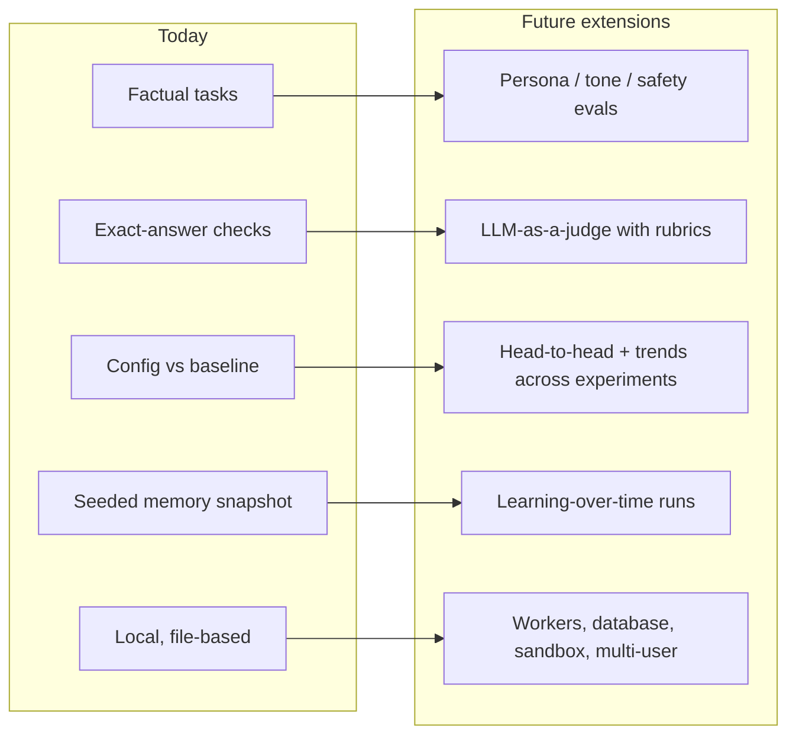

# Known limitations

Agent Eval Lab is built to answer one question well: **"On this suite, is config B better than config A, and how sure can we be?"**

To keep it simple and trustworthy, the first version makes some deliberate scope choices. This page lists each one, why it was made, and how the system can grow from here.

Related docs: [DESIGN.md](DESIGN.md) (how it works) · [COSTS.md](COSTS.md) (what a run costs) · [ASSUMPTIONS.md](ASSUMPTIONS.md) (numbered assumptions).

---

## At a glance

| Area | Today | Why | Future direction |
|---|---|---|---|
| Scoring | Exact checks against known answers | The sample tasks are factual, so code can check them precisely | LLM-as-a-judge for open-ended answers |
| Eval types | Factual accuracy tasks | Clear right/wrong answers make verdicts easy to trust | Persona, tone, safety and multi-turn evals |
| Comparison | Each config vs one baseline | One clear question per config | Head-to-head between any two configs, leaderboards |
| Scope of a verdict | Within one experiment | All configs run under the same conditions | Trend tracking across experiments |
| Memory | Fixed seeded snapshot per config | Every run starts from the same state, so runs are comparable | Learning-over-time experiments |
| Agent | Hermes Agent | Focused integration with one agent | Other agents behind the same runner interface |
| Model provider | OpenAI API | One provider keeps setup to one key | More providers via Hermes |
| Execution | Local, one process | Runs with one command, no infra | Queue + workers for larger suites |
| Storage | JSON files in `data/` | Every result is a file you can open and diff | Database for search and history |
| Isolation | Private Hermes home and workspace per run, tools on the host | Simple and fast for trusted tasks | Container sandbox per run |
| Editing | Tasks and configs in YAML files | Files live in git, with review and history | Editing in the UI |
| Users | Single local user | Personal / team-laptop tool | Shared deployment with login |

---

## Scope map

---

## Scoring and eval types

**Today: exact checks only.** A run is scored by code that compares the agent's answer with the expected one: `answer_json`, `answer_contains` or `file_json`.

**Why:** the sample suite (Indian criminal law, BNS 2023) asks factual questions such as "which section punishes murder?". These have one correct answer, so an exact check is cheaper, faster and more reliable than asking another model to grade. Every mismatch is explained, e.g. `section: expected 103, got 302`.

**Not covered yet:**
- Open-ended answers such as essays, summaries, explanations or code quality.
- Style and behaviour, such as tone, politeness or following a persona.
- Multi-turn conversations. Each task is one prompt and one final answer.

**Future direction:**
- **LLM-as-a-judge.** A fixed judge model grades answers against a rubric and gives a score plus its reasoning, kept separate from the configs under test.
- **Persona testing evals.** Check that the agent stays in a given role or voice across a conversation.
- **Safety and refusal evals.** Check that the agent refuses or redirects when it should.
- **Multi-turn tasks.** Score a whole dialogue, not only the final answer.

**Tips for today:**
- Write tasks that ask for a JSON answer, so `answer_json` can check each field.
- Prefer `answer_json` over `answer_contains`, which is a plain text match.

---

## Comparison and statistics

**Today:**
- Every config is compared with one baseline, inside one experiment.
- A paired bootstrap gives a 95% confidence interval and a verdict: better, worse or inconclusive.

**Why:**
- Comparing everything to a single reference keeps the question simple.
- Running all configs in the same experiment means they share the same tasks, model version and conditions.

**Good to know:**
- With few tasks or trials the interval is wide, so "inconclusive" is common. The results table suggests how many trials might settle it.
- Each config gets its own interval. When you compare many configs at once, confirm a surprising win in a second experiment.
- Per-task changes (improved / regressed / unchanged) are descriptive. The interval decides the verdict.
- By default the CI gate (`pnpm eval:ci`) fails only on "worse". Add `--fail-on inconclusive` for a stricter gate.

**Future direction:**
- Head-to-head verdicts between any two configs, and a leaderboard.
- Tracking a config's score across experiments over time.
- Breakdown by task group, such as "which section" vs "punishment" questions.

---

## Memory and learning

**Today:** memory is a fixed seeded snapshot. Each config can supply a `MEMORY.md`, and every run starts from exactly that text.

**Why:** if memory carried over between runs, later runs would differ from earlier ones and the comparison would not be fair.

**Future direction:** learning-over-time experiments, where memory carries across runs and the report shows a learning curve.

---

## Agent and model

**Today:**
- Hermes Agent, pinned to version 0.15.2, runs as a subprocess.
- Models come from the OpenAI API.
- Skills are installed for a run, but the agent decides on its own whether to load them. That choice is part of what is being tested.

**Why:**
- Pinning one Hermes version keeps runs reproducible.
- One provider keeps setup to a single API key.

**Future direction:**
- **More agents:** they can sit behind the same runner interface.
- **More providers:** these can be enabled through Hermes's provider setting.
- **Version upgrades:** after upgrading Hermes, run the test suite to confirm that session parsing still works.

---

## Cost

**Today:**
- The New run page shows an estimate before launch, based on a typical number of tokens per run and the config's prices.
- Actual spend comes from each run's token counts.

**Good to know:**
- The estimate is the same for every config. Configs with file tools usually make more model calls, so they cost a little more.
- Spend is bounded by `maxTurns`, the task timeout and the number of runs.

**Future direction:**
- A hard budget cap per experiment.
- Estimates per config, based on past runs.

See [COSTS.md](COSTS.md) for the numbers.

---

## Running and operations

**Today:**
- **One process:** a single local server with an in-process queue.
- **File storage:** results are JSON files under `data/experiments/<id>/`.
- **Interrupted experiments:** if the server stops mid-experiment, the experiment is marked interrupted when the server restarts, and "Retry broken" re-runs only the failed runs.

**Why:** this needs no database, no queue service and no Docker. One command starts everything, and every intermediate result is a file you can open.

**Good to know:**
- There is no cancel button yet, and old experiments are not cleaned up automatically. Delete folders in `data/` to free space.
- Fixture files are copied at the start of each run. Avoid editing them while an experiment is running.

**Future direction:**
- Worker processes for large suites.
- A database for search and history.
- Cancel and delete actions in the UI.

---

## Security and isolation

**Today:**
- Each run gets its own private Hermes home and its own copy of the task files.
- Hermes's file and terminal tools run on the host machine.
- The server listens on `127.0.0.1` only.

**Why:** the tasks and fixtures live in the repo and are trusted, so a full sandbox isn't needed for this use.

**Good to know:**
- Run only tasks you trust.
- Run logs and session exports under `data/` can contain prompts and answers. Check them before sharing.

**Future direction:**
- A container sandbox for each run.
- Login and roles for a shared deployment.

---

## Platform

**Supported setup:**
- macOS or Linux. On Windows, use WSL2.
- Node 22+, pnpm and Python 3.11+.

Live step streaming reads Hermes's session database through Node's built-in `node:sqlite`.

**Behind a corporate proxy:** set `EVAL_CA_BUNDLE` in `.env` so Hermes can reach the API.

---

## Sample data

**Today:**
- The sample suite uses the BNS 2023 text as enacted (Gazette copy, 25 Dec 2023).
- Every expected answer was checked against that text.

**Future direction:**
- Follow later amendments.
- Add more suites from other domains: data analysis, coding, support, and persona-driven conversations.

---

## UI

**Today:**
- Tasks and configs are shown read-only. You edit them as YAML files.
- The app is for one local user.

**Why:** YAML files in git give review, history and diffs for free.

**Future direction:**
- Create and edit tasks and configs in the UI, with validation.
- Shared experiments and comments for teams.
