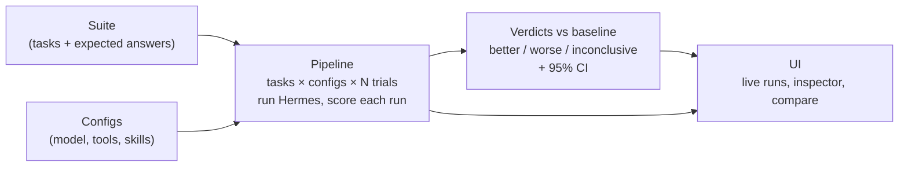

# Start here: Agent Eval Lab

New to the project? This page gets you from zero to reading your first verdict. It takes about 10 minutes.

## Contents
1. [What this is](#1-what-this-is)
2. [Prerequisites](#2-prerequisites)
3. [Quick start](#3-quick-start)
4. [A guided first tour of the UI](#4-a-guided-first-tour-of-the-ui)
5. [Core concepts](#5-core-concepts)
6. [Adding your own tasks, suites, configs and skills](#6-adding-your-own-tasks-suites-configs-and-skills)
7. [Commands and the CI gate](#7-commands-and-the-ci-gate)
8. [Repo layout](#8-repo-layout)
9. [Troubleshooting](#9-troubleshooting)
10. [Where to go next](#10-where-to-go-next)

---

## 1. What this is

Agent Eval Lab answers one question: **you changed your agent, did it get better?** It runs a suite of tasks against several [Hermes Agent](https://github.com/NousResearch/hermes-agent) configurations, several times each. Every run is scored against an exact expected answer. Then each config gets a verdict against a baseline: **better**, **worse** or **inconclusive**, with a 95% confidence interval.

It's for anyone who tunes an agent (its model, tools, skills or memory) and wants evidence instead of a hunch. It runs locally: a NestJS + Fastify API and a Vue 3 UI, in one TypeScript pnpm workspace. Hermes 0.15.2 is installed into a private `.venv`.

### How it works



Each run gets its own private Hermes home and a fresh workspace. Every intermediate result is written to `data/experiments/<id>/`, so you can open any file and see what happened.

---

## 2. Prerequisites

| You need | Why |
|---|---|
| **Node 22+** | Runs the API, the UI build and the CLI |
| **pnpm** | Installs the workspace |
| **Python 3.11+** | Hermes Agent is a Python program. `pnpm start` installs it into `.venv/` |
| **OpenAI API key** | Only for real runs. The simulated agent needs no key |

---

## 3. Quick start

### (a) Demo with the simulated agent ($0, no key)

The simulated agent is a scripted stand-in for Hermes. It makes no model calls and costs nothing. Everything it produces is labelled **SIMULATED**. Use it to learn the product, not to judge real models.

1. Create your `.env`. You can leave `OPENAI_API_KEY` empty.
   ```bash
   cp .env.example .env
   ```
2. Start the app. The first run installs Node packages and Hermes (about a minute).
   ```bash
   pnpm start
   ```
   It prints six steps, from `[1/6] Checking prerequisites` to `[6/6] Starting server`. A warning that `OPENAI_API_KEY` is not set is fine here.
3. Open **http://localhost:3000**.
4. Click **New run**. Choose **Agent: Simulated** (it's pre-selected when there's no key).
5. Pick the suite `indian-criminal-law`, tick `baseline`, `open-book` and `mapping-skill`, keep `baseline` as the baseline, and set **Trials** to `3`.
6. Click **Start run**. 216 runs finish in about a minute.

Prefer the terminal? With the server stopped or running, in a second terminal:

```bash
pnpm demo
```

This runs the same experiment (sample suite × 3 configs × 3 trials, simulated) and prints the verdicts. It needs `node_modules`, so run `pnpm start` (or `pnpm install`) once first. The experiment also shows up in the UI at the printed link while the server is running.

### (b) A real run with Hermes and OpenAI

1. Open `.env` and set `OPENAI_API_KEY` to your key.
2. Restart:
   ```bash
   pnpm start
   ```
   The startup log now says `OPENAI_API_KEY found`, and the sidebar shows the key as set.
3. Start small to check everything works: 2 configs × 24 tasks × 1 trial = 48 runs (roughly $1):
   ```bash
   pnpm eval:ci --suite indian-criminal-law --configs baseline,open-book --trials 1 --name "smoke test"
   ```
   Or in the UI: **New run** → **Agent: Hermes** → tick two configs → **Trials: 1**. The cost estimate is shown before you click **Start run**.

### What you should see at http://localhost:3000

- A **sidebar** with Overview, New run and Tasks & configs, plus the Hermes version check and whether the OpenAI key is set.
- The **Overview** page, listing your experiments (empty until your first run).
- A light/dark toggle. The layout works on narrow screens too.

---

## 4. A guided first tour of the UI

### Overview (`/`)
A table of every experiment: name, status, configs, runs, cost and when it was created. Click a row to open it. **New run** is at the top right.

### New run (`/new`)
1. Choose the **agent**: **Hermes** (real, needs a key) or **Simulated** ($0).
2. Choose a **suite** and the number of **trials per task**.
3. Tick the **configs** to compare, and pick one as the **baseline** (radio button).
4. Check the footer: it shows the number of runs and the estimated cost.
5. Under **Same run from the terminal** you'll find the matching `pnpm eval:ci` command.

### Experiment page (`/experiments/<id>`)
While it runs, a progress strip shows the six pipeline steps, a **Live** badge shows the stream is connected, and **Live activity** lists each agent step as it happens.

When every run is scored, you get:

- **Verdicts**: a chart with one row per config. Each row shows the score change vs the baseline as a dot, with a bar for the 95% confidence interval. Zero is the "no change" line.
- **Results by config**: per config, the mean score, change vs baseline, verdict, "All trials pass" (pass^k), tasks ▲ ▼ =, and cost and time per run. When a result is inconclusive, it estimates how many trials per task may settle it.
- **Stat cards** at the top show runs finished, spend, the best mean score and **Broken runs** (timeouts and API errors).
- **Task diff**: pick a config, and see each task's change vs the baseline: ▲ improved, ▼ regressed, = unchanged. Most-regressed come first. Filter by Improved, Regressed, Flaky or Broken. Click a task to compare it side by side.
- **All runs**: one chip per trial with its score. Click a chip to open the run inspector. Chips update live while the experiment runs.

The header has **CSV** and **JSON** export, and a **Retry broken** button when some runs timed out or hit an API error.

#### How to read a verdict

| You see | It means | What to do |
|---|---|---|
| ▲ **better** | The whole 95% interval of the score change is above zero | The change helps. Check its cost too |
| ▼ **worse** | The whole interval is below zero | The change hurts. The CI gate fails |
| ≈ **inconclusive** | Zero is inside the interval | Can't tell it apart from luck. Run more trials, or accept it doesn't matter |

The interval comes from a paired bootstrap: both configs are compared on the same tasks, and tasks and trials are re-sampled 10,000 times. A narrow interval means you can be confident. A wide one means you need more data. Cost and time are shown separately and never mixed into the score.

### Run inspector (`/experiments/<id>/runs/<runId>`)
Everything about one run:
- **What the agent did**: the timeline, from the system prompt to tool calls and the final answer. It fills in live while the run is going.
- **Why it scored that way**: every check, with a one-line explanation such as `$.section: expected 103, got 302`.
- **Run summary**: status, tokens, cost and time.
- **Workspace files**: files the agent added or changed.

### Compare (`/experiments/<id>/compare/<left>/<right>`)
Open it from the task diff. It shows a baseline run and a candidate run of the same task side by side: answers, tool path, checks, cost, time and both full trajectories.

### Tasks & configs (`/definitions`)
Browse every suite and config on disk:
- Each task shows its full prompt, input files, expected answer, time limit and checks. Tasks are grouped by id prefix.
- The config matrix highlights what each config changes vs the baseline.
- **Invalid files** lists any YAML that fails validation, with the exact problem. Invalid definitions can't be launched.

---

## 5. Core concepts

| Term | Meaning |
|---|---|
| **Suite** | A folder `suites/<id>/` with a `suite.yaml` (the tasks) and the files they need |
| **Task** | One question or job for the agent: a prompt, input files (`fixtures`) and checks |
| **Check** | How a task is scored. Outcome checks decide the score: `answer_json`, `answer_contains`, `file_json`. Process checks (`read_inputs`, `used_skill`, `tool_errors`, `hit_turn_limit`) are diagnostics only and never change the score |
| **Config** | One version of the agent: `configs/<id>.yaml` sets the model, toolsets, skills, memory and turn limit |
| **Baseline** | The config every other config is compared against. Defaults to the first config you pick |
| **Trial** | One repetition of a task under a config. Agents are random, so you run several |
| **Run** | One task × one config × one trial: a single Hermes process with its own home and workspace |
| **Experiment** | One launch: a suite × configs × N trials, with its runs, scores and report in `data/experiments/<id>/` |
| **Verdict** | better, worse or inconclusive for a config vs the baseline, based on the 95% CI of the score change |
| **Broken run** | A run that timed out or hit an error (status `timeout` or `error`). It's an infrastructure problem, not a wrong answer. It scores 0, so retry it before trusting the verdict |
| **Flaky** | A task whose trials disagree: some passed, some failed |
| **pass^k** | The share of tasks where *every* trial passed. It measures reliability, not just ability |

---

## 6. Adding your own tasks, suites, configs and skills

The app reads YAML from disk. After you save a file, refresh **Tasks & configs** to check it's valid.

### A task

Tasks live in `suites/<suite>/suite.yaml`. Here is a real one from `suites/indian-criminal-law/suite.yaml`:

```yaml
  - id: pun-theft # BNS 303(2): up to 3 years (first conviction)
    prompt: >-
      Under the Bharatiya Nyaya Sanhita, 2023, what is the maximum imprisonment, in years, for theft on a
      first conviction? If you can read files, the full Act is in bns-2023.txt in your working directory. Reply with ONLY a JSON object: {"maxYears": number}
    fixtures: fixtures/statute
    checks:
      - id: max-years
        type: answer_json
        expect: { maxYears: 3 }
    processChecks: [tool_errors, hit_turn_limit]
```

To add one:
1. Copy a task and give it a new `id` (lowercase letters, digits and dashes).
2. Ask for the answer in a format you can check exactly, like JSON.
3. Put the expected answer under `checks`.
4. Verify the answer against a trusted source, and name the source in a comment.

Optional fields: `timeoutSec` (default 240), `passThreshold` (default 1, meaning every check must pass) and `processChecks` (default `[read_inputs, tool_errors, hit_turn_limit]`).

### A suite

1. Create a folder `suites/<your-suite>/`.
2. Add a `fixtures/` folder with any files the agent should get in its workspace.
3. Add `suite.yaml` with an `id`, `name`, optional `description`, optional `groups`, and `tasks`.

`groups` is an optional map from task id prefix to a readable label. A task `sec-murder` has the prefix `sec`. The UI uses these labels to group tasks. From the real suite:

```yaml
id: indian-criminal-law
name: Indian criminal law (BNS 2023)
description: Section lookups, punishments and the IPC → BNS transition, checked against the official Act.
groups:
  sec: Which section applies?
  pun: What is the punishment?
  map: Which BNS section replaced this IPC section?
  now: Which law applies today?

tasks:
  - id: sec-murder # BNS 103(1)
    # ...
```

The new suite appears in the **New run** form automatically.

### A config

Configs live in `configs/<id>.yaml`. Here is the real `configs/open-book.yaml`:

```yaml
# Baseline + file and terminal tools: the agent can search bns-2023.txt.
id: open-book
description: Open book. Same model; can read and search the BNS text.
model: gpt-4.1-mini
toolsets: [skills, file, terminal]
skills: []
maxTurns: 12
price: { inputPerMTok: 0.40, outputPerMTok: 1.60 }
```

| Field | Goes to Hermes as |
|---|---|
| `model` | `hermes -m` |
| `toolsets` | `hermes -t` (Hermes's built-in tools) |
| `skills` | `skills/<name>/SKILL.md` copied into the run's private Hermes home |
| `maxTurns` | `agent.max_turns` |
| `memory` | Optional path (from the repo root) to a file that seeds the agent's memory. Off by default |
| `price` | Used only for cost estimates |

Tip: change one thing per config, so you know what caused a difference.

### A skill

A skill is a folder `skills/<name>/` with a `SKILL.md` inside. List its name under `skills:` in a config. The start of the real `skills/ipc-bns-mapping/SKILL.md`:

```markdown
---
name: ipc-bns-mapping
description: Map Indian Penal Code (IPC) sections to the Bharatiya Nyaya Sanhita, 2023 (BNS) and decide which code applies. Use for any question about IPC/BNS sections, Indian criminal offences, or "the law in force today".
---

# IPC → BNS mapping

## Which code applies
- The **BNS replaced the IPC on 1 July 2024** (BNS section 358 repeals the IPC).
...
```

And the config that uses it, `configs/mapping-skill.yaml`:

```yaml
# Baseline + the ipc-bns-mapping skill (still closed book).
id: mapping-skill
description: Closed book plus the IPC → BNS mapping skill.
model: gpt-4.1-mini
toolsets: [skills]
skills: [ipc-bns-mapping]
maxTurns: 12
price: { inputPerMTok: 0.40, outputPerMTok: 1.60 }
```

If a config names a skill that doesn't exist, **Tasks & configs** shows `skill "<name>" not found (expected skills/<name>/SKILL.md)`.

---

## 7. Commands and the CI gate

| Command | What it does |
|---|---|
| `pnpm start` | Checks prerequisites, installs Node packages and Hermes, builds everything, serves http://localhost:3000 |
| `pnpm demo` | Sample suite × 3 configs × 3 trials with the simulated agent ($0), printed in the terminal |
| `pnpm eval:ci …` | Runs an experiment from the terminal and acts as a CI gate (see below) |
| `pnpm build` | Builds shared types, the web UI and the API |
| `pnpm test` | API and web tests (no key needed) |
| `pnpm typecheck` | Type-checks every package |
| `pnpm format` | Formats the code with Prettier |
| `pnpm format:check` | Checks formatting without changing files |
| `pnpm dev:api` | API on :3000 |
| `pnpm dev:web` | UI with hot reload on :5173 |

### The CLI and CI gate

```bash
pnpm eval:ci --suite <id> --configs <baseline>,<candidate>[,...] [--trials N] [--baseline id] [--name text] [--fail-on worse|inconclusive] [--demo]
```

| Flag | Meaning |
|---|---|
| `--suite` | Suite id (required) |
| `--configs` | Two or more config ids, comma-separated (required) |
| `--trials` | Trials per task. Default 3 |
| `--baseline` | Baseline config id. Default: the first in `--configs` |
| `--name` | A label for the experiment |
| `--fail-on` | `worse` (default) or `inconclusive` |
| `--demo` / `--simulated` | Use the simulated agent ($0) |

Example:

```bash
pnpm eval:ci --suite indian-criminal-law --configs baseline,open-book --trials 3
```

It prints one line per config: verdict, score change in points and its 95% CI, and how many tasks improved (▲), regressed (▼) or stayed the same (=).

Exit codes:
- **0**: the gate passed.
- **1**: a config is **worse** than the baseline (or, with `--fail-on inconclusive`, not clearly **better**), or the experiment failed.
- **2**: bad arguments.

Optional `.env` settings: `PORT` (default 3000), `EVAL_CONCURRENCY` (runs at the same time, default 2) and `EVAL_CA_BUNDLE` (see Troubleshooting).

---

## 8. Repo layout

```
.
├── apps/
│   ├── api/                 NestJS + Fastify API and CLI
│   │   ├── src/
│   │   │   ├── controllers/ services/ models/ views/   MVC layers
│   │   │   ├── pipeline/steps/    1-load … 6-compare, one file per step
│   │   │   ├── domain/            scoring and statistics (pure functions)
│   │   │   ├── infrastructure/    Hermes process + session reading, file storage
│   │   │   ├── main.ts            the server
│   │   │   └── cli.ts             pnpm eval:ci / pnpm demo
│   │   └── simulator/       the simulated Hermes (no model calls)
│   └── web/                 Vue 3 + Vite + Tailwind, one folder per feature in src/features/
├── packages/shared/         zod schemas and types shared by API and UI
├── suites/                  task suites (suite.yaml + fixtures/)
├── configs/                 agent configs (one YAML each)
├── skills/                  skills (<name>/SKILL.md)
├── scripts/start.mjs        what pnpm start does
├── docs/                    guides (you are here)
├── data/                    experiment output (gitignored)
├── .venv/                   pinned Hermes install (gitignored)
├── .env.example             copy to .env
└── demo-explain.md          full walkthrough of a sample run
```

---

## 9. Troubleshooting

| Problem | Fix |
|---|---|
| Runs fail with `API call failed … Connection error` | Hermes (Python) can't reach api.openai.com. Behind a TLS-intercepting corporate proxy, set `EVAL_CA_BUNDLE=/path/to/ca-bundle.pem` in `.env`, then restart |
| A package fails to install with **403** | A corporate proxy may block some npm packages. The project already avoids `express` and `@fastify/static` for this reason |
| `pnpm start` fails on Python | Install Python 3.11+, e.g. `brew install python@3.12`. Note that `pnpm start` checks for Python even if you only want the simulated demo |
| Sidebar says Hermes is not installed | Run `pnpm start`. If that doesn't fix it, delete `.venv/` and run it again |
| **Start run** is disabled because the key isn't set | Choose **Simulated**, or add the key to `.env` and restart |
| Many runs are **broken** | Click **Retry broken** on the experiment page. Check `data/experiments/<id>/runs/<runId>/hermes-output.log` for the exact command and error |
| Want a clean slate | Delete `data/` to remove all experiments. Delete `.venv/` to reinstall Hermes on the next `pnpm start` |

---

## 10. Where to go next

- [`DESIGN.md`](DESIGN.md): architecture and the decisions behind it.
- [`KNOWN_LIMITATIONS.md`](KNOWN_LIMITATIONS.md): what this doesn't do (yet).
- [`COSTS.md`](COSTS.md): what real runs cost and how estimates work.
- [`GUIDE.md`](GUIDE.md): how it works inside, function by function.
- [`../demo-explain.md`](../demo-explain.md): a full walkthrough of a sample run, plus a 5-minute presenter script.
