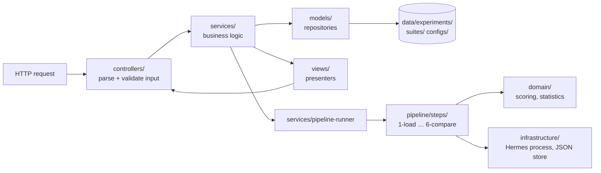

# Code architecture

How the code is organised, and the rules that keep it that way. For *what* the system does and *why*, see [`DESIGN.md`](DESIGN.md).

```
apps/api        NestJS backend (MVC) + the evaluation pipeline
apps/web        Vue 3 frontend (feature folders)
packages/shared zod schemas + TypeScript types used by both
```

---

## Backend: `apps/api/src` (MVC)



```
src/
├── main.ts                    HTTP server (API + built UI on one port)
├── cli.ts                     `pnpm eval:ci` / `pnpm demo`
├── app.module.ts              wires the layers together
│
├── controllers/               C · HTTP only: routes, input validation, response headers
│   ├── definitions.controller.ts   GET /api/definitions, POST /api/estimate
│   ├── experiments.controller.ts   /api/experiments[...]
│   ├── runs.controller.ts          /api/experiments/:id/runs[...]
│   └── health.controller.ts        GET /api/health
├── services/                  business logic (no HTTP, no file paths)
│   ├── experiments.service.ts      start / list / detail / report / retry / export
│   ├── runs.service.ts             run inspector + compare data
│   ├── definitions.service.ts      list definitions, estimate cost
│   └── pipeline-runner.service.ts  sequences steps 1–6, tracks progress
├── models/                    M · repositories: the ONLY code that touches storage
│   ├── experiment.repository.ts    status, plan, scores, report, run files
│   └── definitions.repository.ts   suites / configs / skills / memory (YAML)
├── views/                     V · pure presenters: models → API responses / CSV
│   ├── experiment.view.ts  run.view.ts  definitions.view.ts  export.view.ts
├── dto/                       request schemas (zod)
│   └── create-experiment.dto.ts
│
├── pipeline/steps/            the six pipeline steps, one file each (+ tests)
│   └── 1-load.ts 2-plan.ts 3-prepare.ts 4-execute.ts 5-score.ts 6-compare.ts
├── domain/                    pure, framework-free rules (+ tests)
│   ├── scoring/               outcome checks, process checks, fair matching
│   └── statistics/            paired bootstrap + verdicts
├── infrastructure/            adapters to the outside world
│   ├── hermes/                spawn the CLI, parse its session export
│   └── storage/               JSON file helpers, experiment folder layout
└── config/                    paths, .env loading, model provider
```

### Rules

| Layer | May depend on | Must not |
|---|---|---|
| `controllers/` | services, dto | touch files, contain logic |
| `services/` | models, views, pipeline, domain | know about HTTP (no `req`/`reply`) |
| `models/` | infrastructure/storage, pipeline step 1 | contain business rules |
| `views/` | shared types | do I/O |
| `pipeline/steps/` | domain, infrastructure, config | depend on Nest or repositories |
| `domain/` | shared types only | do I/O or import Nest |

- **One writer.** Only `models/` persists results. Pipeline steps return data, and `PipelineRunner` saves it through `ExperimentRepository`. The exceptions are step 3, which creates the run's folders, and step 4, which writes its raw `hermes-output.log` and `session-export.jsonl`.
- **Pure where possible.** Scoring, statistics, the steps' core logic and the views are plain functions with unit tests.
- **Comments.** Every file starts with a header saying which layer it belongs to and what it is responsible for.

---

## Frontend: `apps/web/src` (feature folders)

```
src/
├── main.ts                     app entry
├── App.vue                     root: AppShell + routed page
├── router/index.ts             all routes in one place
├── api/
│   ├── index.ts                typed fetch client (types from @eval-lab/shared)
│   ├── events.ts               SSE client for live experiment events
│   └── queryKeys.ts            TanStack Query keys (one source of truth)
├── composables/
│   ├── useTheme.ts             app-wide state (light/dark)
│   └── useExperimentStream.ts  live run updates over SSE, polling fallback
├── components/                 shared, presentational
│   ├── layout/                 AppShell, SidebarNav, EnvironmentStatus, ThemeToggle
│   ├── ui/                     AppIcon, VerdictBadge, SimulatedBadge, StatCard, PanelCard
│   ├── charts/                 ForestPlot (verdicts with 95% CI)
│   ├── pipeline/               PipelineFlow (animated diagram)
│   └── run/                    TimelineItem, ScoringPanel, trajectory.logic.ts
├── features/
│   ├── experiments/            overview: experiment table, how a run works
│   ├── new-run/                the launch form + CLI equivalent
│   ├── experiment-detail/      verdicts, results table, task diff, live activity, run grid
│   ├── run-inspector/          one run: trajectory + why it scored so
│   ├── run-compare/            two runs side by side
│   └── definitions/            config matrix, tasks grouped by kind
├── styles/main.css             design tokens (light + dark), animations
└── utils/                      pure helpers (format.ts, activity.ts)
```

Every feature folder has the same shape, which is the repo's 3-layer rule:

```
features/<feature>/
├── <Feature>Page.vue           composition: wires the composable to components (routed)
├── components/*.vue            presentational: props in, events out, no fetching
├── composables/use<Feature>.ts data + state (TanStack Query, refs)
├── <feature>.logic.ts          pure functions (no Vue, no I/O)
└── <feature>.logic.test.ts     unit tests for the logic
```

### Rules
- **Components don't fetch.** All server data comes through composables, using keys from `api/queryKeys.ts`.
- **Logic lives in `*.logic.ts`**, so it can be unit-tested without mounting components.
- **The web app imports only *types* from `@eval-lab/shared`.** The shared package is built as CommonJS for the API.
- **Colours are theme tokens** (`text-good`, `bg-ink-900`…) defined in `styles/main.css`, so every component works in light and dark mode.

---

## Commands

```bash
pnpm test           # API (40) + web (24) unit/integration tests
pnpm typecheck      # all packages
pnpm format         # Prettier (config in .prettierrc.json)
pnpm format:check
```

ESLint isn't set up: its dependency tree is blocked by the corporate npm proxy in the environment this was built in. TypeScript strict mode and Prettier are the guardrails.
